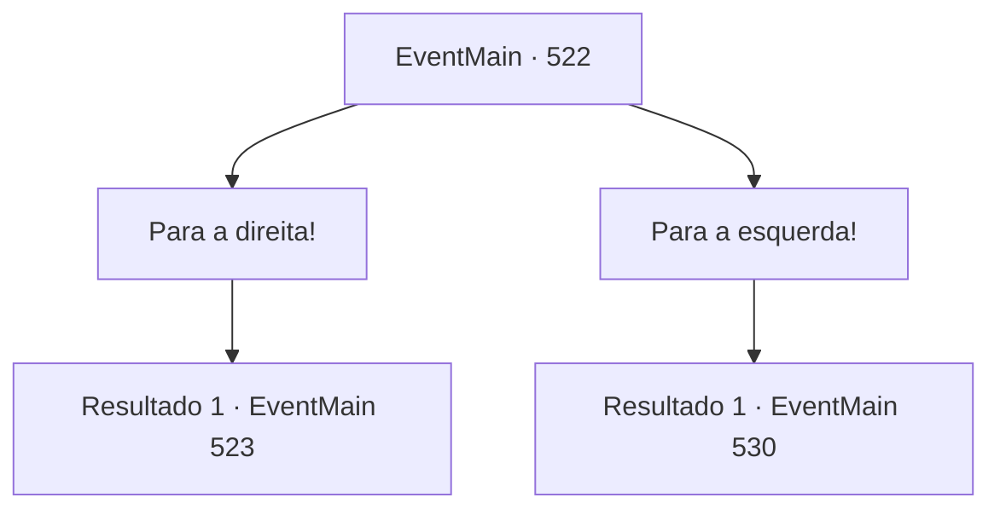

# Eventos principais · 522

[Índice da tabela](index.md) · [Índice geral](../index.md)

ID: `pt:EventMain:522` · Fonte: `EventMain4` · Versão: 1.2.47.

Mapeamento estático dos arquivos; a disponibilidade e a execução dependem do estado da run.

## Texto do evento

*Sem texto no arquivo.*

## Dados de entrada

```json
{
  "id": 522,
  "grade": 1,
  "normalGoal": "",
  "required": ""
}
```

## Mapa das escolhas



## Escolhas e resultados

### Escolha 1

Para a direita!

Requisitos e outros campos da escolha:

```json
{
  "required": ""
}
```

#### Resultado 1.1

Você caminha pelo caminho certo. O corredor subterrâneo é decorado com estátuas de pedra em forma de monstros e ocasionalmente você vê um pedestal vazio ou armadura empoeirada. Você está prestes a passar por uma armadura completa em exibição. De repente, ela se move e começa a balançar sua espada em sua direção.

Continuação registrada: [Evento 523](0523.md) na mesma tabela.

```json
{
  "required": "",
  "chance": "1",
  "nextEvent": 523,
  "type": 2,
  "reward": "6_0_150",
  "place": 6
}
```

### Escolha 2

Para a esquerda!

Requisitos e outros campos da escolha:

```json
{
  "required": ""
}
```

#### Resultado 2.1

Você caminha pelo caminho da esquerda. O túnel subterrâneo está escuro e você não consegue enxergar muito bem à sua frente. Mas ao seguir pela parede, você consegue perceber em qual direção está caminhando. Depois de caminhar por um longo tempo, você de repente para. Você se deparou com um beco sem saída, sem nenhuma maneira de prosseguir. Justo quando você está prestes a virar, de repente você ouve um barulho alto.

 'Koo-goo-goo-goo-goo-goo-goo-goo-gung'

 Com um rugido, barras descem de cima e te prendem instantaneamente. Logo depois, você ouve um som metálico grotesco, e o teto espinhoso começa a descer lentamente.

Continuação registrada: [Evento 530](0530.md) na mesma tabela.

```json
{
  "required": "",
  "chance": "1",
  "nextEvent": 530,
  "type": 2,
  "reward": ""
}
```

## Referências que chegam a este evento

- [Evento 521 · escolha 1 · resultado 1](0521.md#escolha-1)
