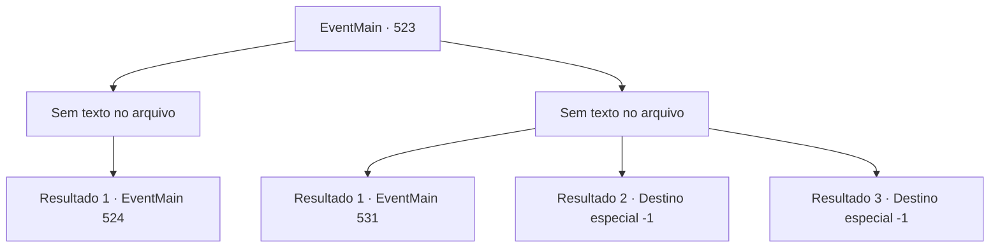

# Eventos principais · 523

[Índice da tabela](index.md) · [Índice geral](../index.md)

ID: `pt:EventMain:523` · Fonte: `EventMain4` · Versão: 1.2.47.

Mapeamento estático dos arquivos; a disponibilidade e a execução dependem do estado da run.

## Texto do evento

*Sem texto no arquivo.*

## Dados de entrada

```json
{
  "id": 523,
  "grade": 1,
  "normalGoal": "",
  "required": ""
}
```

## Mapa das escolhas



## Escolhas e resultados

### Escolha 1

*Sem texto no arquivo; o papel dessa opção depende da interface do jogo.*

Requisitos e outros campos da escolha:

```json
{
  "required": ""
}
```

#### Resultado 1.1

Você quebra a armadura em movimento e continua avançando.

 Há quanto tempo você está caminhando? Finalmente, você chega ao fim da estrada. Você para de caminhar e olha ao redor. O lugar para onde você finalmente chegou é uma sala vazia. Não há nem mesmo um único móvel - apenas poeira acumulada.

Continuação registrada: [Evento 524](0524.md) na mesma tabela.

```json
{
  "required": "",
  "chance": "1",
  "nextEvent": 524,
  "type": 2,
  "reward": ""
}
```

### Escolha 2

*Sem texto no arquivo; o papel dessa opção depende da interface do jogo.*

Requisitos e outros campos da escolha:

```json
{
  "required": ""
}
```

#### Resultado 2.1

A armadura em movimento balança sua espada como um cavaleiro fiel e nunca para o ataque. Tudo o que você pode fazer contra um inimigo assim é fugir.

 Quando você sai do túnel subterrâneo e abre a porta do mosteiro, ouve muitos passos ao longe. Logo você encontra a origem do som. Viyork veio ao mosteiro com seus homens. Viyork olha para você na entrada e fala com um estalo de língua. 

 "Tsk... Parece que você falhou em matar Publius."

 Ele coloca a mão no seu ombro com um sorriso suspeito. 

 "Mas não se preocupe. {1}. Eu te disse. Tenho um plano em prática. Siga-me."

 Com uma pequena risada, ele lidera seus homens ao longo do planalto.

Continuação registrada: [Evento 531](0531.md) na mesma tabela.

```json
{
  "required": "1_0_2|1_1_2",
  "chance": "1",
  "nextEvent": 531,
  "type": 2,
  "reward": "0_0_-1|0_1_-1"
}
```

#### Resultado 2.2

A armadura em movimento balança sua espada como um cavaleiro fiel e nunca para o ataque. Eventualmente, você perde a consciência após um ataque implacável da armadura em movimento.

Continuação registrada: [Destino especial `-1`](../destinos-especiais.md).

```json
{
  "required": "2_0_2",
  "chance": "1",
  "nextEvent": -1,
  "type": 2,
  "reward": "0_0_-1|0_1_-1|15_5_13|15_5_38"
}
```

#### Resultado 2.3

A armadura em movimento balança sua espada como um cavaleiro fiel e nunca para o ataque. Eventualmente, você perde a consciência após um ataque implacável da armadura em movimento.

Continuação registrada: [Destino especial `-1`](../destinos-especiais.md).

```json
{
  "required": "2_1_2",
  "chance": "1",
  "nextEvent": -1,
  "type": 2,
  "reward": "0_0_-1|0_1_-1|15_5_13|15_5_38"
}
```

## Referências que chegam a este evento

- [Evento 522 · escolha 1 · resultado 1](0522.md#escolha-1)
- [Evento 530 · escolha 1 · resultado 1](0530.md#escolha-1)
- [Evento 530 · escolha 1 · resultado 2](0530.md#escolha-1)
- [Evento 530 · escolha 2 · resultado 1](0530.md#escolha-2)
- [Evento 530 · escolha 2 · resultado 2](0530.md#escolha-2)
- [Evento 530 · escolha 3 · resultado 1](0530.md#escolha-3)
