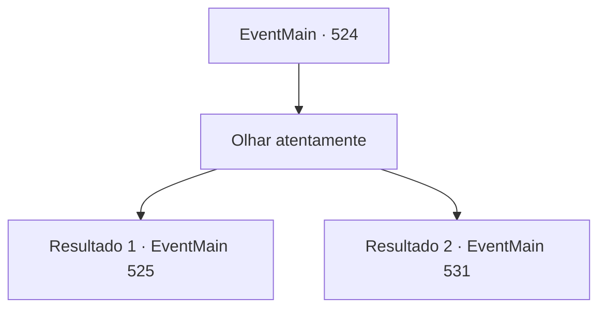

# Eventos principais · 524

[Índice da tabela](index.md) · [Índice geral](../index.md)

ID: `pt:EventMain:524` · Fonte: `EventMain4` · Versão: 1.2.47.

Mapeamento estático dos arquivos; a disponibilidade e a execução dependem do estado da run.

## Texto do evento

*Sem texto no arquivo.*

## Dados de entrada

```json
{
  "id": 524,
  "grade": 1,
  "normalGoal": "",
  "required": ""
}
```

## Mapa das escolhas



## Escolhas e resultados

### Escolha 1

Olhar atentamente

Requisitos e outros campos da escolha:

```json
{
  "required": ""
}
```

#### Resultado 1.1

Depois de procurar por muito tempo, você toca cuidadosamente a parede e sente algo estranho. Um passagem secreta aparece com um clique. Você continua perseguindo Publius ao longo da passagem recém-identificada.

 A passagem secreta eventualmente se abre em algum lugar do Planalto Aether. Quando você chega, vê Publius respirando pesadamente. Ele grita com uma expressão chocada. 

 "Oh, como você chegou aqui...!"

 Não há motivo para você responder essa pergunta. Você saca sua arma imediatamente e a balança em direção a Publius.

Continuação registrada: [Evento 525](0525.md) na mesma tabela.

```json
{
  "required": "",
  "chance": "1|0_7_1",
  "nextEvent": 525,
  "type": 0,
  "reward": "6_3_151",
  "place": 0
}
```

#### Resultado 1.2

Você procura lá por muito tempo, mas não encontra nada. Eventualmente, decide adiar sua vingança e sair.

 Quando sai do túnel subterrâneo e abre a porta do mosteiro, ouve muitos passos ao longe. Logo encontra a origem do som. Viyork veio ao mosteiro com seus homens. Viyork olha para você na entrada e fala com um estalo de língua. 

 "Tsk... Parece que você falhou em matar Publius."

 Ele coloca a mão no seu ombro com um sorriso suspeito. 

 "Mas não se preocupe. {1}. Eu te disse. Tenho um plano em andamento. Siga-me."

 Com uma pequena risada, ele lidera seus homens ao longo do planalto.

Continuação registrada: [Evento 531](0531.md) na mesma tabela.

```json
{
  "required": "",
  "chance": "16",
  "nextEvent": 531,
  "type": 1,
  "reward": ""
}
```

## Referências que chegam a este evento

- [Evento 523 · escolha 1 · resultado 1](0523.md#escolha-1)
