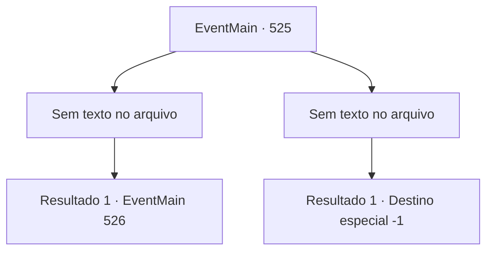

# Eventos principais · 525

[Índice da tabela](index.md) · [Índice geral](../index.md)

ID: `pt:EventMain:525` · Fonte: `EventMain4` · Versão: 1.2.47.

Mapeamento estático dos arquivos; a disponibilidade e a execução dependem do estado da run.

## Texto do evento

*Sem texto no arquivo.*

## Dados de entrada

```json
{
  "id": 525,
  "grade": 1,
  "normalGoal": "",
  "required": ""
}
```

## Mapa das escolhas



## Escolhas e resultados

### Escolha 1

*Sem texto no arquivo; o papel dessa opção depende da interface do jogo.*

Requisitos e outros campos da escolha:

```json
{
  "required": ""
}
```

#### Resultado 1.1

Publius cai de joelhos e deixa cair uma lâmpada dourada. Há uma energia sagrada emanando da lâmpada. Parece ser um objeto muito especial. Você a pega e se aproxima de Publius. 

 "Tossindo! S... Seus pecados nunca serão perdoados por Tere!!"

 Você ergue sua arma em desafio à condenação de Publius. Você esmaga sua cabeça e Publius desaba. Você rapidamente se vira, sentindo de repente uma presença sinistra. Viyork, que apareceu sem aviso, sorri e balança sua espada em sua direção.

Continuação registrada: [Evento 526](0526.md) na mesma tabela.

```json
{
  "required": "",
  "chance": "1",
  "nextEvent": 526,
  "type": 2,
  "reward": "3_246_1"
}
```

### Escolha 2

*Sem texto no arquivo; o papel dessa opção depende da interface do jogo.*

Requisitos e outros campos da escolha:

```json
{
  "required": ""
}
```

#### Resultado 2.1


 "Meu Deus, Tere! Por favor, me dê o poder para derrotar o mal!"

 Uma lança de luz sagrada voa de Publius e te perfura. Você cai de joelhos, tossindo sangue. Logo você desaba no chão e não consegue se levantar. Antes que sua audição desapareça completamente, você consegue distinguir a voz de alguém. É a voz de Viyork. 

 "... Bem, eu gostaria que você tivesse matado Publius antes de morrer. Mas suponho que você me poupou o trabalho de sujar minhas mãos com o seu sangue..."

 Logo vem a escuridão completa e o silêncio.

Continuação registrada: [Destino especial `-1`](../destinos-especiais.md).

```json
{
  "required": "",
  "chance": "1",
  "nextEvent": -1,
  "type": 2,
  "reward": "0_0_-1|0_1_-1|15_5_13|15_5_38"
}
```

## Referências que chegam a este evento

- [Evento 524 · escolha 1 · resultado 1](0524.md#escolha-1)
