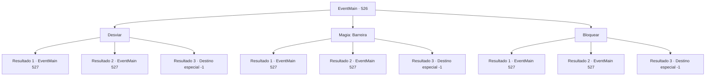

# Eventos principais · 526

[Índice da tabela](index.md) · [Índice geral](../index.md)

ID: `pt:EventMain:526` · Fonte: `EventMain4` · Versão: 1.2.47.

Mapeamento estático dos arquivos; a disponibilidade e a execução dependem do estado da run.

## Texto do evento

*Sem texto no arquivo.*

## Dados de entrada

```json
{
  "id": 526,
  "grade": 1,
  "normalGoal": "",
  "required": ""
}
```

## Mapa das escolhas



## Escolhas e resultados

### Escolha 1

Desviar

Requisitos e outros campos da escolha:

```json
{
  "required": ""
}
```

#### Resultado 1.1

Você rapidamente desvia da espada dele e grita para Viyork: 'O que você está fazendo?'. Viyork responde à pergunta irritada com um rosto calmo. 

 "Uau, você ainda não percebeu? Agora que Publius está morto, eu não preciso mais de você."

 Viyork ri de você e levanta a mão despreocupadamente. Então seus homens, que estavam escondidos entre os arbustos, pulam para fora. 

 "Bem, agora que você sabe, por favor, morra. Sua vingança tão esperada foi alcançada, então você deveria me fazer um favor e me deixar te matar. Por que mais eu teria te seguido até aqui?"

 Assim que ele termina de falar, Viyork e seus homens te atacam.

Continuação registrada: [Evento 527](0527.md) na mesma tabela.

```json
{
  "required": "",
  "chance": "1|0_6_1",
  "nextEvent": 527,
  "type": 0,
  "reward": "6_3_147",
  "place": 0
}
```

#### Resultado 1.2

Você se esquiva rapidamente, mas sua espada rasga seu ombro. Com dor, você franze o rosto e grita: 'O que você está fazendo?'. Viyork responde à pergunta irritada com um rosto calmo. 

 "Uau, você ainda não percebeu? Agora que Publius está morto, eu não preciso mais de você."

 Viyork ri de você e levanta a mão despreocupadamente. Então seus homens, que estavam escondidos entre os arbustos, pulam para fora. 

 "Bem, agora que você sabe, por favor, morra. Sua vingança tão esperada foi alcançada, então você deveria me fazer um favor e me deixar te matar. Por que mais eu teria te seguido até aqui?"

 Assim que ele termina de falar, Viyork e seus homens te atacam.

Continuação registrada: [Evento 527](0527.md) na mesma tabela.

```json
{
  "required": "1_0_2",
  "chance": "14",
  "nextEvent": 527,
  "type": 1,
  "reward": "0_0_-1|6_3_147",
  "place": 0
}
```

#### Resultado 1.3

Você não consegue desviar da espada dele e ele corta seu peito. Enquanto você vacila em uma dor tonturante, Viyork ergue sua espada e a atravessa seu coração. 

 "Você fez um ótimo trabalho. {1}. Mas já que você alcançou sua vingança, não viveu o suficiente?"

 Você encara Viyork com sangue jorrando de suas feridas. No entanto, sua visão gradualmente fica embaçada e logo você não consegue ver mais nada. Então você morre ouvindo o escárnio de Viyork.

Continuação registrada: [Destino especial `-1`](../destinos-especiais.md).

```json
{
  "required": "2_0_2",
  "chance": "14",
  "nextEvent": -1,
  "type": 1,
  "reward": "0_0_-1|15_5_2|15_5_13|15_5_22"
}
```

### Escolha 2

Magia: Barreira

Requisitos e outros campos da escolha:

```json
{
  "required": "20_0_2|1_1_2"
}
```

#### Resultado 2.1

Você conjura uma Barreira para parar sua espada e grita para Viyork: 'O que você está fazendo?'. Viyork responde à pergunta irritada com um rosto calmo. 

 "Uau, você ainda não percebeu? Agora que Publius está morto, eu não preciso mais de você."

 Viyork ri de você e levanta a mão despreocupadamente. Então seus homens, que estavam escondidos entre os arbustos, pulam para fora. 

 "Bem, agora que você sabe, por favor, morra. Sua vingança tão esperada foi alcançada, então você deveria me fazer um favor e me deixar te matar. Por que mais eu teria te seguido até aqui?"

 Assim que ele termina de falar, Viyork e seus homens te atacam.

Continuação registrada: [Evento 527](0527.md) na mesma tabela.

```json
{
  "required": "",
  "chance": "1|0_14_1",
  "nextEvent": 527,
  "type": 0,
  "reward": "6_3_147|0_1_-1",
  "place": 0
}
```

#### Resultado 2.2

Você tenta conjurar Barreira, mas sua espada rasga seu ombro. Com dor, você franze o rosto e grita: 'O que você está fazendo?'. Viyork responde à pergunta irritada com um rosto calmo. 

 "Uau, você ainda não percebeu? Agora que Publius está morto, eu não preciso mais de você."

 Viyork ri de você e levanta a mão despreocupadamente. Então seus homens, que estavam escondidos entre os arbustos, pulam para fora. 

 "Bem, agora que você sabe, por favor, morra. Sua vingança tão esperada foi alcançada, então você deveria me fazer um favor e me deixar te matar. Por que mais eu teria te seguido até aqui?"

 Assim que ele termina de falar, Viyork e seus homens te atacam.

Continuação registrada: [Evento 527](0527.md) na mesma tabela.

```json
{
  "required": "1_0_2",
  "chance": "14",
  "nextEvent": 527,
  "type": 1,
  "reward": "0_0_-1|6_3_147|0_1_-1",
  "place": 0
}
```

#### Resultado 2.3

Você tenta conjurar Barreira, mas ele acaba cortando seu peito. Enquanto você vacila em uma dor tonturante, Viyork levanta sua espada e a atravessa seu coração. 

 "Você fez um ótimo trabalho. {1}. Mas já que você conseguiu sua vingança, não viveu o suficiente?"

 Você encara Viyork com sangue jorrando de suas feridas. No entanto, sua visão gradualmente fica embaçada e logo você não consegue ver mais nada. Então você morre ouvindo o escárnio de Viyork.

Continuação registrada: [Destino especial `-1`](../destinos-especiais.md).

```json
{
  "required": "2_0_2",
  "chance": "14",
  "nextEvent": -1,
  "type": 1,
  "reward": "0_0_-1|15_5_2|15_5_13|15_5_22|0_1_-1"
}
```

### Escolha 3

Bloquear

Requisitos e outros campos da escolha:

```json
{
  "required": "20_9_1"
}
```

#### Resultado 3.1

Você bloqueia sua espada e grita para Viyork: 'O que você está fazendo?'. Viyork responde à pergunta irritada com um rosto calmo. 

 "Uau, você ainda não percebeu? Agora que Publius está morto, eu não preciso mais de você."

 Viyork ri de você e levanta a mão despreocupadamente. Então seus homens, que estavam escondidos entre os arbustos, pulam para fora. 

 "Bem, agora que você sabe, por favor morra. Sua vingança tão esperada foi alcançada, então você deveria me fazer um favor e me deixar te matar. Por que mais eu teria te seguido até aqui?"

 Assim que ele termina de falar, Viyork e seus homens te atacam.

Continuação registrada: [Evento 527](0527.md) na mesma tabela.

```json
{
  "required": "",
  "chance": "1|0_13_1",
  "nextEvent": 527,
  "type": 0,
  "reward": "6_3_147",
  "place": 0
}
```

#### Resultado 3.2

Tentas bloquear o ataque de Viyork, mas a sua espada rasga o teu ombro. Com dor, franzes o rosto e gritas: 'O que estás a fazer?'. Viyork responde à pergunta irritada com um rosto calmo. 

 "Uau, ainda não percebeste? Agora que o Publius está morto, eu não preciso de ti."

 Viyork ri-se de ti e levanta a mão despreocupadamente. Então os seus homens, que estavam escondidos entre os arbustos, saltam para fora. 

 "Bem, agora que sabes, por favor morre. A tua vingança tão esperada foi alcançada, por isso faz-me um favor e deixa-me matar-te. Por que mais eu te teria seguido até aqui?"

 Assim que ele termina de falar, Viyork e os seus homens atacam-te.

Continuação registrada: [Evento 527](0527.md) na mesma tabela.

```json
{
  "required": "1_0_2",
  "chance": "10",
  "nextEvent": 527,
  "type": 1,
  "reward": "0_0_-1|6_3_147",
  "place": 0
}
```

#### Resultado 3.3

Tentas bloquear a espada de Viyork, mas ele acaba por cortar o teu peito. Enquanto vacilas numa dor vertiginosa, Viyork ergue a sua espada e atravessa o teu coração. 

 "Fizeste um ótimo trabalho. {1}. Mas já que alcançaste a tua vingança, não viveste o suficiente?"

 Olhas fixamente para Viyork com sangue jorrando das tuas feridas. No entanto, a tua visão gradualmente fica turva e em breve não consegues ver nada. Assim, morres a ouvir o escárnio de Viyork.

Continuação registrada: [Destino especial `-1`](../destinos-especiais.md).

```json
{
  "required": "2_0_2",
  "chance": "10",
  "nextEvent": -1,
  "type": 1,
  "reward": "0_0_-1|15_5_2|15_5_13|15_5_22"
}
```

## Referências que chegam a este evento

- [Evento 525 · escolha 1 · resultado 1](0525.md#escolha-1)
