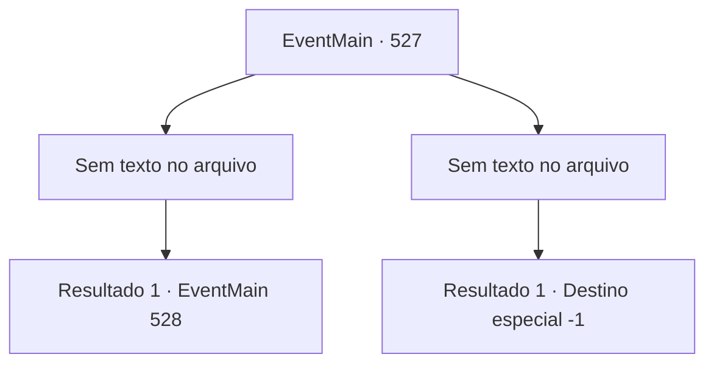

# Eventos principais · 527

[Índice da tabela](index.md) · [Índice geral](../index.md)

ID: `pt:EventMain:527` · Fonte: `EventMain4` · Versão: 1.2.47.

Mapeamento estático dos arquivos; a disponibilidade e a execução dependem do estado da run.

## Texto do evento

*Sem texto no arquivo.*

## Dados de entrada

```json
{
  "id": 527,
  "grade": 1,
  "normalGoal": "",
  "required": ""
}
```

## Mapa das escolhas



## Escolhas e resultados

### Escolha 1

*Sem texto no arquivo; o papel dessa opção depende da interface do jogo.*

Requisitos e outros campos da escolha:

```json
{
  "required": ""
}
```

#### Resultado 1.1

O planalto está manchado de sangue, e Viyork cai no chão. Você extrai as almas dos paladinos sangrando e morrendo, então se aproxima lentamente de Viyork. Viyork grita para você com uma expressão atordoada. 

 "Oh, meu Deus! Você demônio! Vá embora! Ah, Argh!!!"

 Você se certifica de que o gritante Viyork nunca mais gritará. Um sorriso puxa os cantos da sua boca. Então você ouve a voz de Kior. 

 "Bom trabalho. {1}. Agora me dê as almas deles."

 Conforme ele lhe diz, você dedica as almas de Viyork e Publius a Kior. Então Kior explode em risadas de satisfação. 

 "Khahaha!!! Ótimo! Que excelente! Bem, eu vou recompensá-lo por sua dedicação. Receba minha força. Eu lhe darei poder como você nunca experimentou antes."

 E então, com esse poder, ele lhe ordena que apague todos os vestígios de Tere.

Continuação registrada: [Evento 528](0528.md) na mesma tabela.

```json
{
  "required": "",
  "chance": "1",
  "nextEvent": 528,
  "type": 2,
  "reward": ""
}
```

### Escolha 2

*Sem texto no arquivo; o papel dessa opção depende da interface do jogo.*

Requisitos e outros campos da escolha:

```json
{
  "required": ""
}
```

#### Resultado 2.1

Você cai de joelhos enquanto Viyork e seus homens atacam ferozmente. O cheiro de ferro quente sobe pela sua garganta. E sangue vermelho escorre pela sua boca. Ao ver isso, Viyork sorri e grita. 

 "Levem essa alma maligna agora mesmo! Viyork de Tere executará esse vilão!"

 Por ordem dele, os homens de Viyork agarram seus braços e começam a arrastá-lo para algum lugar. Você fecha os olhos, sentindo toda a tensão em seu corpo se dissipar. Assim termina em vão a sua jornada.

Continuação registrada: [Destino especial `-1`](../destinos-especiais.md).

```json
{
  "required": "",
  "chance": "1",
  "nextEvent": -1,
  "type": 2,
  "reward": "0_0_-1|0_1_-1|15_5_2|15_5_13|15_5_22"
}
```

## Referências que chegam a este evento

- [Evento 526 · escolha 1 · resultado 1](0526.md#escolha-1)
- [Evento 526 · escolha 1 · resultado 2](0526.md#escolha-1)
- [Evento 526 · escolha 2 · resultado 1](0526.md#escolha-2)
- [Evento 526 · escolha 2 · resultado 2](0526.md#escolha-2)
- [Evento 526 · escolha 3 · resultado 1](0526.md#escolha-3)
- [Evento 526 · escolha 3 · resultado 2](0526.md#escolha-3)
- [Evento 533 · escolha 1 · resultado 1](0533.md#escolha-1)
