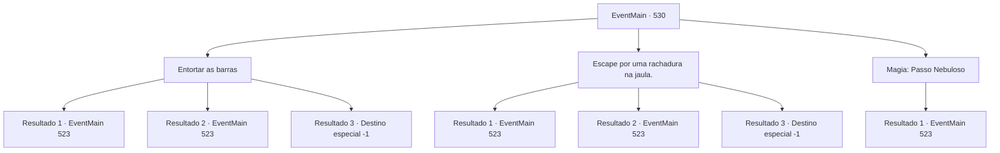

# Eventos principais · 530

[Índice da tabela](index.md) · [Índice geral](../index.md)

ID: `pt:EventMain:530` · Fonte: `EventMain4` · Versão: 1.2.47.

Mapeamento estático dos arquivos; a disponibilidade e a execução dependem do estado da run.

## Texto do evento

*Sem texto no arquivo.*

## Dados de entrada

```json
{
  "id": 530,
  "grade": 1,
  "normalGoal": "",
  "required": ""
}
```

## Mapa das escolhas



## Escolhas e resultados

### Escolha 1

Entortar as barras

Requisitos e outros campos da escolha:

```json
{
  "required": ""
}
```

#### Resultado 1.1

Você rapidamente dobra as barras e escapa. Você volta pelo caminho que veio e, desta vez, na bifurcação, você segue para a direita.

 O corredor subterrâneo é decorado com estátuas de pedra em forma de monstros e ocasionalmente você vê um pedestal vazio ou armadura empoeirada. Você está prestes a passar por uma armadura completa em exibição. De repente, ela se move e começa a balançar sua espada em sua direção.

Continuação registrada: [Evento 523](0523.md) na mesma tabela.

```json
{
  "required": "",
  "chance": "1|0_5_1",
  "nextEvent": 523,
  "type": 0,
  "reward": "6_0_150",
  "place": 6
}
```

#### Resultado 1.2

Tentas escapar dobrando as barras. No entanto, as barras não dobram facilmente, mesmo com força. Então, recuas e depois corres o mais rápido que podes em direção a elas. As barras quebram com um estrondo, mas também sentes uma dor aguda no ombro. Depois de escapar com a tua vida, voltas pelo caminho que vieste e, desta vez, na bifurcação, segues para a direita.

 O corredor subterrâneo é decorado com estátuas de pedra em forma de monstros e, ocasionalmente, vês um pedestal vazio ou uma armadura empoeirada. Estás prestes a passar por uma armadura completa em exposição. De repente, ela mexe-se e começa a balançar a sua espada em tua direção.

Continuação registrada: [Evento 523](0523.md) na mesma tabela.

```json
{
  "required": "",
  "chance": "16",
  "nextEvent": 523,
  "type": 1,
  "reward": "0_0_-1|6_0_150",
  "place": 6
}
```

#### Resultado 1.3

Você tenta dobrar as barras, mas é uma tentativa improvável. Eventualmente, você não consegue escapar do teto desabando. Você sente seu peso enquanto ele começa a te esmagar. 

 "Ah não... Estávamos quase lá... Que pena..."

 Você mal ouve Kior clicando a língua.

Continuação registrada: [Destino especial `-1`](../destinos-especiais.md).

```json
{
  "required": "",
  "chance": "16",
  "nextEvent": -1,
  "type": 1,
  "reward": "0_0_-1|15_5_13|15_5_38"
}
```

### Escolha 2

Escape por uma rachadura na jaula.

Requisitos e outros campos da escolha:

```json
{
  "required": ""
}
```

#### Resultado 2.1

Você se move flexivelmente pelos vãos das barras e escapa. Você volta pelo caminho que veio e, desta vez, na bifurcação, você segue para a direita.

 A passagem subterrânea é decorada com estátuas de pedra em forma de monstros e ocasionalmente você vê um pedestal vazio ou uma armadura empoeirada. Você está prestes a passar por uma armadura completa em exibição. De repente, ela se move e começa a balançar sua espada em sua direção.

Continuação registrada: [Evento 523](0523.md) na mesma tabela.

```json
{
  "required": "",
  "chance": "1|0_6_1",
  "nextEvent": 523,
  "type": 0,
  "reward": "6_0_150",
  "place": 6
}
```

#### Resultado 2.2

Você se move flexivelmente através das rachaduras das barras e tenta escapar. Há um momento em que seu ombro fica preso nas barras, mas você consegue torcê-lo e puxá-lo com força. Você volta pelo caminho que veio e, desta vez, na bifurcação, você segue para a direita.

 O corredor subterrâneo é decorado com estátuas de pedra em forma de monstros e ocasionalmente você vê um pedestal vazio ou uma armadura empoeirada. Você está prestes a passar por uma armadura completa em exibição. De repente, ela se move e começa a balançar sua espada em sua direção.

Continuação registrada: [Evento 523](0523.md) na mesma tabela.

```json
{
  "required": "",
  "chance": "16",
  "nextEvent": 523,
  "type": 1,
  "reward": "0_0_-1|6_0_150",
  "place": 6
}
```

#### Resultado 2.3

Tentas escapar do vão entre as barras, mas a abertura estreita não permite. Eventualmente, não consegues escapar do teto que desce. Sentes o seu peso enquanto começa a esmagar-te. 

 "Ah não... Estávamos quase lá... Que pena..."

 Mal ouves Kior estalando a língua.

Continuação registrada: [Destino especial `-1`](../destinos-especiais.md).

```json
{
  "required": "",
  "chance": "16",
  "nextEvent": -1,
  "type": 1,
  "reward": "0_0_-1|15_5_13|15_5_38"
}
```

### Escolha 3

Magia: Passo Nebuloso

Requisitos e outros campos da escolha:

```json
{
  "required": "20_0_1|1_1_2"
}
```

#### Resultado 3.1

Você rapidamente contorce seu corpo como se fosse feito de gás e desliza por uma abertura entre as barras. Você volta pelo caminho que veio e, desta vez, na bifurcação, você segue para a direita.

 O corredor subterrâneo é decorado com estátuas de pedra em forma de monstros e ocasionalmente você vê um pedestal vazio ou armadura empoeirada. Você está prestes a passar por uma armadura completa em exibição. De repente, ela se move e começa a balançar sua espada em sua direção.

Continuação registrada: [Evento 523](0523.md) na mesma tabela.

```json
{
  "required": "",
  "chance": "1",
  "nextEvent": 523,
  "type": 2,
  "reward": "6_0_150|0_1_-1",
  "place": 6
}
```

## Referências que chegam a este evento

- [Evento 522 · escolha 2 · resultado 1](0522.md#escolha-2)
