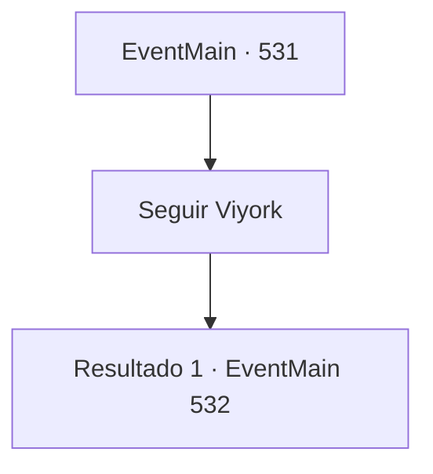

# Eventos principais · 531

[Índice da tabela](index.md) · [Índice geral](../index.md)

ID: `pt:EventMain:531` · Fonte: `EventMain4` · Versão: 1.2.47.

Mapeamento estático dos arquivos; a disponibilidade e a execução dependem do estado da run.

## Texto do evento

*Sem texto no arquivo.*

## Dados de entrada

```json
{
  "id": 531,
  "grade": 1,
  "normalGoal": "",
  "required": ""
}
```

## Mapa das escolhas



## Escolhas e resultados

### Escolha 1

Seguir Viyork

Requisitos e outros campos da escolha:

```json
{
  "required": ""
}
```

#### Resultado 1.1

Em pouco tempo, você ouve o som de alguém lutando. O som se aproxima cada vez mais, e você pode ver a origem do barulho quando chega ao pé do penhasco. Publius está lutando contra os paladinos que se uniram a Viyork. Alguns dos paladinos já estão sangrando muito. Apenas dois deles estão atacando Publius. Viyork aponta para os paladinos lutando e ri baixinho. 

 "Huhu. Eu tenho homens que eram próximos a ele. Foi assim que eu soube deste esconderijo e da passagem secreta."

 Ele cruza os braços com arrogância, ordenando que seus homens parem de lutar com Publius. 

 "Vou te dar uma chance de desferir o último golpe."

 Acenando para ele, você saca sua arma e corre em direção a Publius. Publius, que mal percebeu sua presença, estende a mão em sua direção.

Continuação registrada: [Evento 532](0532.md) na mesma tabela.

```json
{
  "required": "",
  "chance": "1",
  "nextEvent": 532,
  "type": 2,
  "reward": "6_0_151",
  "place": 10
}
```

## Referências que chegam a este evento

- [Evento 521 · escolha 2 · resultado 1](0521.md#escolha-2)
- [Evento 523 · escolha 2 · resultado 1](0523.md#escolha-2)
- [Evento 524 · escolha 1 · resultado 2](0524.md#escolha-1)
