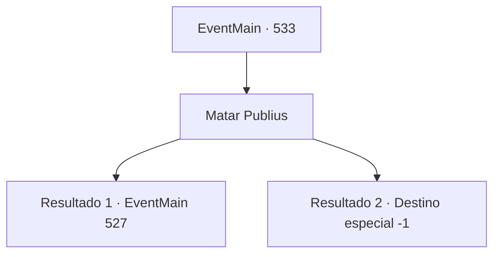

# Eventos principais · 533

[Índice da tabela](index.md) · [Índice geral](../index.md)

ID: `pt:EventMain:533` · Fonte: `EventMain4` · Versão: 1.2.47.

Mapeamento estático dos arquivos; a disponibilidade e a execução dependem do estado da run.

## Texto do evento

*Sem texto no arquivo.*

## Dados de entrada

```json
{
  "id": 533,
  "grade": 1,
  "normalGoal": "",
  "required": ""
}
```

## Mapa das escolhas



## Escolhas e resultados

### Escolha 1

Matar Publius

Requisitos e outros campos da escolha:

```json
{
  "required": ""
}
```

#### Resultado 1.1

Você ergue sua arma, ignorando a condenação de Publius. E você acaba com a vida dele. <color=red>

 "Bom trabalho. {1}. Mas agora... Eu quero que você morra!"

</color> A dor repentina de uma traição que você sente te deixa tonto, e você grita. Quando você olha para trás, vê Viyork segurando uma espada ensanguentada. 

 "Aparentemente isso não foi o suficiente para te matar... Ataque!"

 Logo Viyork e seus homens se aproximam correndo em sua direção.

Continuação registrada: [Evento 527](0527.md) na mesma tabela.

```json
{
  "required": "1_0_2",
  "chance": "1",
  "nextEvent": 527,
  "type": 2,
  "reward": "0_0_-1|6_3_147",
  "place": 10
}
```

#### Resultado 1.2

Você ergue sua arma, ignorando a condenação de Publius. E você acaba com a vida dele. <color=red>

 "Bom trabalho. {1}. Mas agora... Eu quero que você morra!"

</color> Você cai com um grito quando sente uma dor ardente nas costas. O mundo começa a escurecer e você ouve a voz satisfeita de Viyork. 

 "Já que você alcançou sua vingança, pode morrer sem arrependimentos. Adeus, {1}."


Continuação registrada: [Destino especial `-1`](../destinos-especiais.md).

```json
{
  "required": "2_0_2",
  "chance": "1",
  "nextEvent": -1,
  "type": 2,
  "reward": "0_0_-1|15_5_13|15_5_22"
}
```

## Referências que chegam a este evento

- [Evento 532 · escolha 1 · resultado 1](0532.md#escolha-1)
