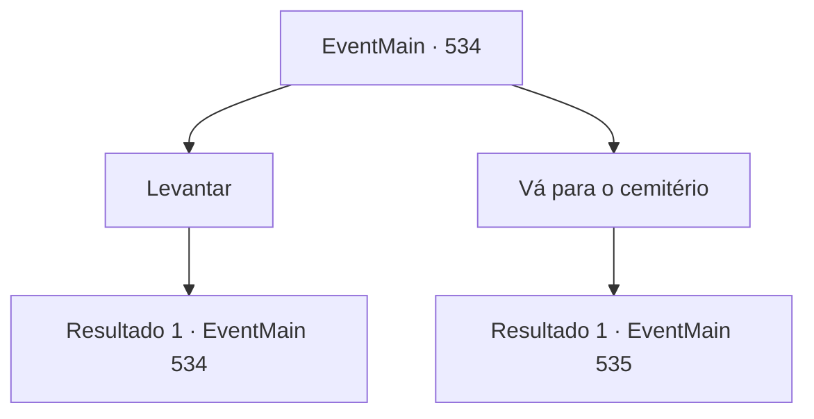

# Eventos principais · 534

[Índice da tabela](index.md) · [Índice geral](../index.md)

ID: `pt:EventMain:534` · Fonte: `EventMain4` · Versão: 1.2.47.

Mapeamento estático dos arquivos; a disponibilidade e a execução dependem do estado da run.

## Texto do evento

Você caminhava por um beco deserto, tentando encontrar o caminho até a catedral. De repente, figuras envoltas em mantos cinzentos surgiram, bloqueando sua passagem. Eles caíram de joelhos rapidamente, e o homem à frente, com a voz trêmula, falou:  

 "Oh, g-grande... Contratante do pacto... Eu, Gess, humildemente im-imploro... Nós, humildes servos, ofereceremos nossas vidas ao serviço do mestre... Por favor, nos guie e nos conduza!"

  Enquanto você os observava em silêncio, Kior sussurrou em sua mente:  

 "São adoradores meus... Hmm, podem ser úteis. Use-os para eliminar Publius."

  Os cultistas permaneciam ajoelhados, aguardando suas ordens em silêncio absoluto.

## Dados de entrada

```json
{
  "id": 534,
  "grade": 1,
  "normalGoal": "",
  "required": "1_2_100|13_4_25"
}
```

## Mapa das escolhas



## Escolhas e resultados

### Escolha 1

Levantar

Requisitos e outros campos da escolha:

```json
{
  "required": "5_377_0"
}
```

#### Resultado 1.1

Você diz aos adoradores para levantarem e pergunta a eles pelo que vieram. Um homem se referiu a si mesmo como 'Gess' responde com voz trêmula. 

 "Nós, Nós esperamos que nosso mestre e você, o contratante, alcancem o objetivo. Então, trazemos informações importantes."|drawing_gess| Gess tem cabelos brancos, suas gengivas estão colapsadas e seus olhos estão turvos. Mas sua expressão está cheia de convicção. 

 "Primeiro, esta é a localização da catedral que o contratante está procurando."

 Gess tira um mapa de seus braços, mostra para você e continua falando. O velho mapa mostra o caminho para a Catedral de Yerut. 

 "Mas você não pode ir imediatamente. Por causa da barreira lá. Você encontrará dificuldades para usar o poder do mestre."

 Mas ele disse, não se preocupe, acrescentando que havia encontrado outro caminho. 

 "Vá para o cemitério da catedral."

 Gess diz que há um túmulo de uma santa chamada Paella no cemitério da igreja de Teretian. Paella também era conhecida como uma brilhante feiticeira em sua vida, pois alguns objetos de enterro eram arreios que neutralizavam a corrente. 

 "Mesmo que você não encontre as ferramentas magias de Paella... Se você lutar descontroladamente lá, eles não virão?"

 Se você lutar fora da Catedral de Yerut, não precisa se preocupar com as consequências, então qualquer caminho é benéfico, Gess acrescenta.

Continuação registrada: [Evento 534](0534.md) na mesma tabela.

```json
{
  "required": "",
  "chance": "1",
  "nextEvent": 534,
  "type": 2,
  "reward": "5_377_1"
}
```

### Escolha 2

Vá para o cemitério

Requisitos e outros campos da escolha:

```json
{
  "required": "5_377_1"
}
```

#### Resultado 2.1

Você lidera os adoradores de demônios até o cemitério da catedral. Fica perto da cidade de 'Legirique', chamada de Terra Santa de Teretian. Felizmente, não está longe da vila onde você está. 

 Ande por horas assim, e você chegará ao cemitério da catedral. Ao se aproximar dos adoradores, um cemitério com a marca de Tere em volta do pescoço bloqueia você. 

 "Este é um lugar sagrado e você não pode entrar sem permissão dos altos sacerdotes de Teretian"

.

Continuação registrada: [Evento 535](0535.md) na mesma tabela.

```json
{
  "required": "",
  "chance": "1",
  "nextEvent": 535,
  "type": 2,
  "reward": ""
}
```

## Referências que chegam a este evento

- [Evento 534 · escolha 1 · resultado 1](0534.md#escolha-1)
