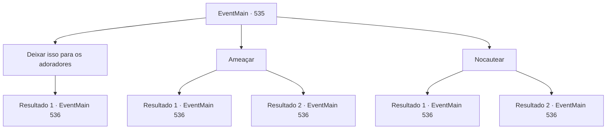

# Eventos principais · 535

[Índice da tabela](index.md) · [Índice geral](../index.md)

ID: `pt:EventMain:535` · Fonte: `EventMain4` · Versão: 1.2.47.

Mapeamento estático dos arquivos; a disponibilidade e a execução dependem do estado da run.

## Texto do evento

*Sem texto no arquivo.*

## Dados de entrada

```json
{
  "id": 535,
  "grade": 1,
  "normalGoal": "",
  "required": ""
}
```

## Mapa das escolhas



## Escolhas e resultados

### Escolha 1

Deixar isso para os adoradores

Requisitos e outros campos da escolha:

```json
{
  "required": ""
}
```

#### Resultado 1.1

Você olha para os adoradores e eles entendem o que você quer dizer. Os adoradores se apressam e rapidamente transformam o cemitério em um membro do cemitério. Enquanto isso, Gess se aproxima e pergunta a você. 

 "Con, Contratante. O que, o que devemos f, fazer agora?"


Continuação registrada: [Evento 536](0536.md) na mesma tabela.

```json
{
  "required": "",
  "chance": "1",
  "nextEvent": 536,
  "type": 2,
  "reward": ""
}
```

### Escolha 2

Ameaçar

Requisitos e outros campos da escolha:

```json
{
  "required": ""
}
```

#### Resultado 2.1

Você ameaça o guarda do cemitério para ir embora. O guarda do cemitério move suas pernas trêmulas de medo e foge. Então Gess se aproxima e fala com você. 

 "Como eu esperava, você é incrível. Então, o que faremos agora?"


Continuação registrada: [Evento 536](0536.md) na mesma tabela.

```json
{
  "required": "",
  "chance": "1|0_12_1",
  "nextEvent": 536,
  "type": 0,
  "reward": "0_3_-1"
}
```

#### Resultado 2.2

Você ameaça o guarda do cemitério para ir embora. No entanto, o guarda cheira e ri. 

 "Ha...! Eu não sei o que você está tentando fazer. Saia daqui! Os paladinos de Tere..."

 As palavras do cemitério não continuam até o fim. Isso porque adoradores animados correm, derrubam ele e rapidamente o tornam membro do cemitério. E Gess se aproxima e fala com você. 

 "Con, Contratante. O que, o que devemos fazer agora?"


Continuação registrada: [Evento 536](0536.md) na mesma tabela.

```json
{
  "required": "",
  "chance": "13",
  "nextEvent": 536,
  "type": 1,
  "reward": ""
}
```

### Escolha 3

Nocautear

Requisitos e outros campos da escolha:

```json
{
  "required": ""
}
```

#### Resultado 3.1

Você esmaga o rosto do guarda do cemitério com toda a força que pode. Com um som alegre de batida, o corpo do guarda cai como um tronco. Então Gess se aproxima e fala com você. 

 "Como eu esperava, você é incrível. Então, o que faremos agora?"


Continuação registrada: [Evento 536](0536.md) na mesma tabela.

```json
{
  "required": "",
  "chance": "1|0_5_1",
  "nextEvent": 536,
  "type": 0,
  "reward": "0_3_-1"
}
```

#### Resultado 3.2

Você esmaga o rosto do guarda do cemitério com toda a força que pode. Com um som alegre de batida, a cabeça do guarda vira. 

 "O que diabos?!"

 O guarda dá um tapa no seu rosto com raiva, e sua cabeça também vira. Então, adoradores animados correm, derrubam ele e rapidamente o tornam membro do cemitério. E Gess se aproxima e fala com você. 

 "Con, Contratante. O que, o que devemos fazer agora?"


Continuação registrada: [Evento 536](0536.md) na mesma tabela.

```json
{
  "required": "",
  "chance": "12",
  "nextEvent": 536,
  "type": 1,
  "reward": ""
}
```

## Referências que chegam a este evento

- [Evento 534 · escolha 2 · resultado 1](0534.md#escolha-2)
