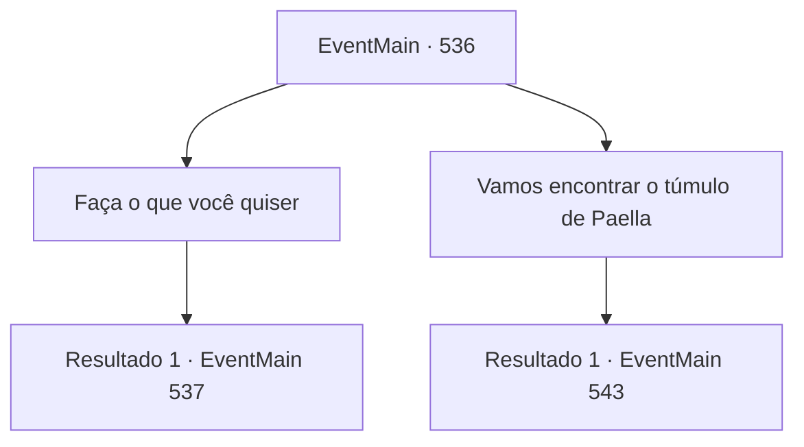

# Eventos principais · 536

[Índice da tabela](index.md) · [Índice geral](../index.md)

ID: `pt:EventMain:536` · Fonte: `EventMain4` · Versão: 1.2.47.

Mapeamento estático dos arquivos; a disponibilidade e a execução dependem do estado da run.

## Texto do evento

*Sem texto no arquivo.*

## Dados de entrada

```json
{
  "id": 536,
  "grade": 1,
  "normalGoal": "",
  "required": ""
}
```

## Mapa das escolhas



## Escolhas e resultados

### Escolha 1

Faça o que você quiser

Requisitos e outros campos da escolha:

```json
{
  "required": ""
}
```

#### Resultado 1.1

Você instrui os adoradores a causarem uma perturbação. Ao receberem a ordem, os adoradores começam a cavar sepulturas, atear fogo e destruir cemitérios. Em particular, Gess até mesmo cria um morto-vivo a partir dos restos dos sacerdotes. Então, ele ri tão alto que sua boca fica presa em sua orelha. Entre os sacerdotes trazidos de volta como mortos-vivos estão Onil, Danica e Viyork, que você matou. |drawing_undeads| Quanto tempo se passou? Um dos adoradores de guarda se aproxima apressadamente e lhe diz. 

 "Contratante! Eles estão vindo! Paladinos de Tere!!"

 Você olha para os mortos-vivos, planejando maneiras de lidar com os paladinos.

Continuação registrada: [Evento 537](0537.md) na mesma tabela.

```json
{
  "required": "",
  "chance": "1",
  "nextEvent": 537,
  "type": 2,
  "reward": ""
}
```

### Escolha 2

Vamos encontrar o túmulo de Paella

Requisitos e outros campos da escolha:

```json
{
  "required": "5_378_0"
}
```

#### Resultado 2.1

Você procura pelo túmulo de Paella com adoradores. Entre as inúmeras sepulturas, seu túmulo fica na borda mais externa do cemitério, sob uma árvore espessa. Mas não é suficiente ser um túmulo. Apenas um monumento é erguido em seu túmulo, mas não há espaço para um caixão. Quando você olha para o monumento, vê caracteres misteriosos. 

 "P, Provavelmente, está escondido assim para esconder a ferramenta magia de Paella."

 Você ouve Gess e olha novamente para a lápide de Paella.

Continuação registrada: [Evento 543](0543.md) na mesma tabela.

```json
{
  "required": "",
  "chance": "1",
  "nextEvent": 543,
  "type": 2,
  "reward": "5_378_1"
}
```

## Referências que chegam a este evento

- [Evento 535 · escolha 1 · resultado 1](0535.md#escolha-1)
- [Evento 535 · escolha 2 · resultado 1](0535.md#escolha-2)
- [Evento 535 · escolha 2 · resultado 2](0535.md#escolha-2)
- [Evento 535 · escolha 3 · resultado 1](0535.md#escolha-3)
- [Evento 535 · escolha 3 · resultado 2](0535.md#escolha-3)
- [Evento 543 · escolha 1 · resultado 2](0543.md#escolha-1)
- [Evento 544 · escolha 1 · resultado 1](0544.md#escolha-1)
- [Evento 544 · escolha 2 · resultado 1](0544.md#escolha-2)
- [Evento 544 · escolha 4 · resultado 1](0544.md#escolha-4)
