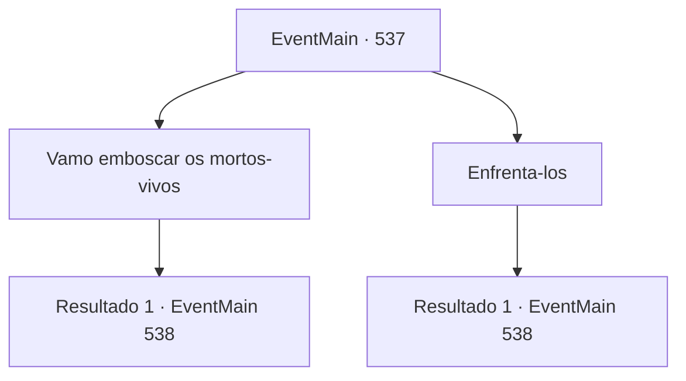

# Eventos principais · 537

[Índice da tabela](index.md) · [Índice geral](../index.md)

ID: `pt:EventMain:537` · Fonte: `EventMain4` · Versão: 1.2.47.

Mapeamento estático dos arquivos; a disponibilidade e a execução dependem do estado da run.

## Texto do evento

*Sem texto no arquivo.*

## Dados de entrada

```json
{
  "id": 537,
  "grade": 1,
  "normalGoal": "",
  "required": ""
}
```

## Mapa das escolhas



## Escolhas e resultados

### Escolha 1

Vamo emboscar os mortos-vivos

Requisitos e outros campos da escolha:

```json
{
  "required": "1_7_14"
}
```

#### Resultado 1.1

Você explica a operação aos adoradores e esconde os mortos-vivos no cemitério da catedral. Eles se escondem no chão onde estão. 

 Uma hora depois, como Gess disse, os paladinos de Teretian aparecem no cemitério. 

 "Todos. Prontos para a batalha!"

 O líder deles é a mulher de cabelos vermelhos que você conheceu da última vez. Gess olha para ela e a descreve como a melhor paladina de Tere, 'Valen'. Os paladinos avançam e se chocam com os adoradores enquanto ela saca sua espada. E naquele exato momento, os mortos-vivos se levantam de suas sepulturas e seguram os paladinos pelos tornozelos. 

 "Emboscada!"

 Quando o corpo de um colega ataca-os repentinamente, os paladinos ficam em caos. Valen grita para seus homens e então salta em sua direção com poder sagrado.

Continuação registrada: [Evento 538](0538.md) na mesma tabela.

```json
{
  "required": "",
  "chance": "1",
  "nextEvent": 538,
  "type": 2,
  "reward": "6_2_148",
  "place": 4
}
```

### Escolha 2

Enfrenta-los

Requisitos e outros campos da escolha:

```json
{
  "required": ""
}
```

#### Resultado 2.1

Você espera pelos paladinos com os mortos-vivos à frente. Porque você precisa abalar suas mentes para derrubar os paladinos de Tere. 

 Uma hora depois, como Gess disse, os paladinos de Teretian aparecem no cemitério. Os paladinos parecem muito chocados quando veem seus colegas mortos-vivos. E o choque logo se transforma em raiva. 

 "Descansem para nossos irmãos e irmãs!"

 A líder deles é a mulher de cabelos vermelhos que você conheceu da última vez. Gess olha para ela e a descreve como a melhor paladina de Tere, 'Valen'. Enquanto Valen desembainha sua espada, os paladinos começam a atacar os mortos-vivos. Eles empunham armas sem hesitação, mesmo contra seus colegas mortos-vivos. Você percebe que a operação de atacar sua sanidade falhou, mas você não pode recuar agora. Valen e os paladinos avançam em sua direção com poder sagrado.

Continuação registrada: [Evento 538](0538.md) na mesma tabela.

```json
{
  "required": "",
  "chance": "1",
  "nextEvent": 538,
  "type": 2,
  "reward": "6_0_148",
  "place": 4
}
```

## Referências que chegam a este evento

- [Evento 536 · escolha 1 · resultado 1](0536.md#escolha-1)
