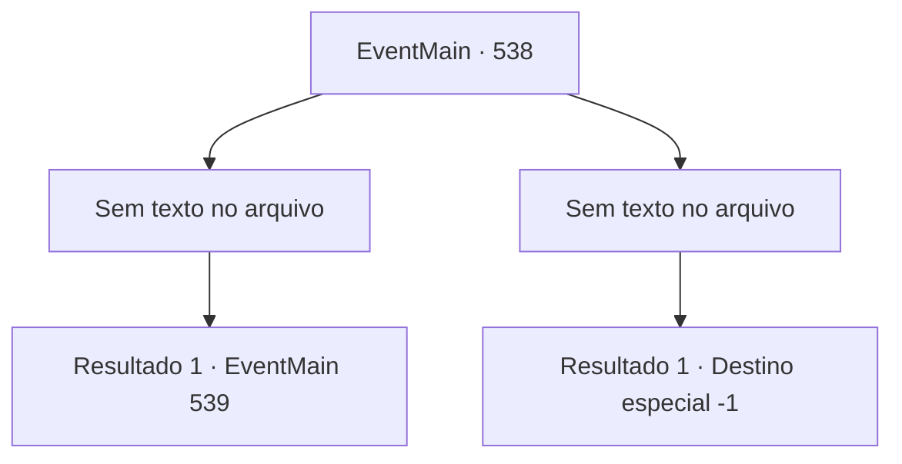

# Eventos principais · 538

[Índice da tabela](index.md) · [Índice geral](../index.md)

ID: `pt:EventMain:538` · Fonte: `EventMain4` · Versão: 1.2.47.

Mapeamento estático dos arquivos; a disponibilidade e a execução dependem do estado da run.

## Texto do evento

*Sem texto no arquivo.*

## Dados de entrada

```json
{
  "id": 538,
  "grade": 1,
  "normalGoal": "",
  "required": ""
}
```

## Mapa das escolhas



## Escolhas e resultados

### Escolha 1

*Sem texto no arquivo; o papel dessa opção depende da interface do jogo.*

Requisitos e outros campos da escolha:

```json
{
  "required": ""
}
```

#### Resultado 1.1

A espada que envolve a luz sagrada e a espada que envolve o mana cinza colidem. O martelo prateado esmaga o crânio do morto-vivo, a lança segura com osso, e o muco penetra pela armadura do paladino. 

 "Luz!!"

 Pó de cinzas é espalhado junto com a luz que se eleva por todo o cemitério da catedral. A 'Expulsão de Mortos-Vivos' é tentada para devolver os mortos-vivos ao submundo. As coisas estão começando a se voltar contra você. Percebendo isso, você se apressa em Valen para decidir a batalha rapidamente. E pega o osso quebrado e o esfaqueia no pescoço. <link=shake>

 "Valen...!!"

</link> Naquele momento, uma lança de luz voa com alguém gritando o nome dela. Você evita o ataque e verifica o homem que lançou a lança de luz. Ao mesmo tempo, você reconhece intuitivamente que ele é 'Publius' em um uniforme colorido de padre vermelho.

Continuação registrada: [Evento 539](0539.md) na mesma tabela.

```json
{
  "required": "",
  "chance": "1",
  "nextEvent": 539,
  "type": 2,
  "reward": ""
}
```

### Escolha 2

*Sem texto no arquivo; o papel dessa opção depende da interface do jogo.*

Requisitos e outros campos da escolha:

```json
{
  "required": ""
}
```

#### Resultado 2.1

A espada que envolve a luz sagrada e a espada que envolve o mana cinza colidiram. O martelo prateado esmagou o crânio do morto-vivo, a lança agarrou-se ao osso e o muco penetrou na armadura do paladino. 

 "Luz!!"

 Pó de cinzas se espalha junto com a luz que se eleva por todo o cemitério da catedral. A 'Expulsão de Mortos-Vivos' é tentada para enviar os mortos-vivos de volta ao submundo. E com isso, sua arma é desviada. Sangue escorre pela sua bochecha superficial e os olhos frios de Valen se fixam em você. 

 "É a sua derrota, adorador sujo de demônios."

 No final da frase, Valen te acerta na cabeça com a empunhadura da espada. Com esse golpe, você perde a consciência.

Continuação registrada: [Destino especial `-1`](../destinos-especiais.md).

```json
{
  "required": "",
  "chance": "1",
  "nextEvent": -1,
  "type": 2,
  "reward": "0_0_-1|0_1_-1|15_5_2|15_5_13|15_5_17"
}
```

## Referências que chegam a este evento

- [Evento 537 · escolha 1 · resultado 1](0537.md#escolha-1)
- [Evento 537 · escolha 2 · resultado 1](0537.md#escolha-2)
