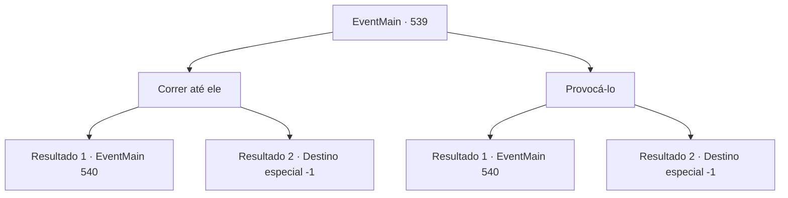

# Eventos principais · 539

[Índice da tabela](index.md) · [Índice geral](../index.md)

ID: `pt:EventMain:539` · Fonte: `EventMain4` · Versão: 1.2.47.

Mapeamento estático dos arquivos; a disponibilidade e a execução dependem do estado da run.

## Texto do evento

*Sem texto no arquivo.*

## Dados de entrada

```json
{
  "id": 539,
  "grade": 1,
  "normalGoal": "",
  "required": ""
}
```

## Mapa das escolhas



## Escolhas e resultados

### Escolha 1

Correr até ele

Requisitos e outros campos da escolha:

```json
{
  "required": ""
}
```

#### Resultado 1.1

Há muitos cavaleiros sagrados entre você e Publius. Reconhecendo seu olhar, eles tentam urgentemente bloquear a frente de Publius. Mas mais rápido do que isso, você passa por eles e corre em direção a Publius. 

 "Kh! Demônio! Vá embora!"

 A luz de sua mão é direcionada a você. Você vai além daquela luz brilhante e crava suas presas de vingança em Publius.

Continuação registrada: [Evento 540](0540.md) na mesma tabela.

```json
{
  "required": "",
  "chance": "1|0_6_1",
  "nextEvent": 540,
  "type": 0,
  "reward": "6_0_151",
  "place": 4
}
```

#### Resultado 1.2

Há muitos cavaleiros sagrados entre você e Publius. Reconhecendo seu olhar, eles tentam urgentemente bloquear a frente de Publius. 

 "Você tem que evitar isso! Senhor!"

 Enquanto isso, alguns dos paladinos evacuam urgentemente Publius. E assim tudo o que você pode fazer é olhar para o fugitivo Publius lutando contra os paladinos. Inúmeros paladinos estão sangrando. 

 "Co,Contratante! Evite primeiro! A si, situação não está bo, boa!"

 Ao ouvir a voz urgente de Gess, você olha ao redor. A maioria dos mortos-vivos foi reduzida a cinzas e a maioria dos adoradores ficou ferida. Como ele disse, parece difícil lutar mais como está. Você foge dali com os adoradores.

Continuação registrada: [Destino especial `-1`](../destinos-especiais.md).

```json
{
  "required": "",
  "chance": "16",
  "nextEvent": -1,
  "type": 1,
  "reward": "15_5_18|15_5_41"
}
```

### Escolha 2

Provocá-lo

Requisitos e outros campos da escolha:

```json
{
  "required": ""
}
```

#### Resultado 2.1

Você cospe no corpo de Valen. Então você coloca o pé na cabeça dela, pisa nela e insulta. 

 "Como, como você se atreve...!"

 Publius, que testemunhou a aparição, esquece sua calma e corre em sua direção. Isso é o que você esperava.

Continuação registrada: [Evento 540](0540.md) na mesma tabela.

```json
{
  "required": "",
  "chance": "1|0_12_1",
  "nextEvent": 540,
  "type": 0,
  "reward": "6_0_151",
  "place": 4
}
```

#### Resultado 2.2

Você cospe no corpo de Valen. Então você coloca o pé em sua cabeça, pisa nela e a insulta. 

 "Você tem que evitar isso! Senhor!"

 Publius, que testemunhou a aparição, esquece sua calma e tenta correr em sua direção. No entanto, os paladinos ao lado dele o bloqueiam e o evacuam apressadamente. E assim tudo o que você pode fazer é observar o fugitivo Publius lutando contra os paladinos. Inúmeros paladinos estão sangrando. 

 "Co,Contratante! Evite primeiro! A si, situação não está bo, boa!"

 Ao ouvir a voz urgente de Gess, você olha ao redor. A maioria dos mortos-vivos foi reduzida a cinzas e a maioria dos adoradores ficou ferida. Como ele disse, parece difícil lutar mais como está. Você foge dali com os adoradores.

Continuação registrada: [Destino especial `-1`](../destinos-especiais.md).

```json
{
  "required": "",
  "chance": "16",
  "nextEvent": -1,
  "type": 1,
  "reward": "15_5_18|15_5_41"
}
```

## Referências que chegam a este evento

- [Evento 538 · escolha 1 · resultado 1](0538.md#escolha-1)
