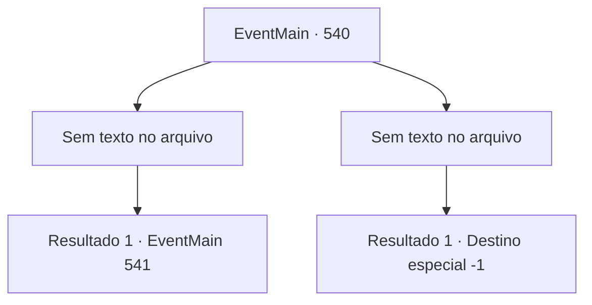

# Eventos principais · 540

[Índice da tabela](index.md) · [Índice geral](../index.md)

ID: `pt:EventMain:540` · Fonte: `EventMain4` · Versão: 1.2.47.

Mapeamento estático dos arquivos; a disponibilidade e a execução dependem do estado da run.

## Texto do evento

*Sem texto no arquivo.*

## Dados de entrada

```json
{
  "id": 540,
  "grade": 1,
  "normalGoal": "",
  "required": ""
}
```

## Mapa das escolhas



## Escolhas e resultados

### Escolha 1

*Sem texto no arquivo; o papel dessa opção depende da interface do jogo.*

Requisitos e outros campos da escolha:

```json
{
  "required": ""
}
```

#### Resultado 1.1

Publius cambaleia diante de você. Você não perde tempo e põe fim à sua vida. Um sorriso se forma em torno de sua boca, com seu sangue respingando em sua bochecha. 

 "Valen e o arcebispo morreram...! Recuar!"

 Com a morte dos dois sumos sacerdotes, os paladinos começam a fugir em confusão. Você ordena aos adoradores que persigam e dediquem as almas de Valen e Publius a Kior. Então Kior explode em risos de satisfação. 

 "Khahaha!!! Ótimo! É excelente! Bem, vou retribuir sua dedicação. Receba minha força. Vou te dar a força que você nunca experimentou antes."

 E então, com esse poder, Ele te ordena que apague tudo sobre Teretian.

Continuação registrada: [Evento 541](0541.md) na mesma tabela.

```json
{
  "required": "",
  "chance": "1",
  "nextEvent": 541,
  "type": 2,
  "reward": ""
}
```

### Escolha 2

*Sem texto no arquivo; o papel dessa opção depende da interface do jogo.*

Requisitos e outros campos da escolha:

```json
{
  "required": ""
}
```

#### Resultado 2.1

A luz de Publius queima você. Naquele terrível golpe de calor, você grita e cai. Você não tem mais forças para lutar. 

 "Th, O contratante...!"

 A voz de Gess, que é interrompida, morre com o som de um guincho. Junto com isso vem a voz fria de Publius. 

 "Tenho certeza de que ainda está vivo. Arraste-o para longe."

 Você perde a consciência com a sensação de alguém segurando você.

Continuação registrada: [Destino especial `-1`](../destinos-especiais.md).

```json
{
  "required": "",
  "chance": "1",
  "nextEvent": -1,
  "type": 2,
  "reward": "0_0_-1|0_1_-1|15_5_2|15_5_13|15_5_17"
}
```

## Referências que chegam a este evento

- [Evento 539 · escolha 1 · resultado 1](0539.md#escolha-1)
- [Evento 539 · escolha 2 · resultado 1](0539.md#escolha-2)
