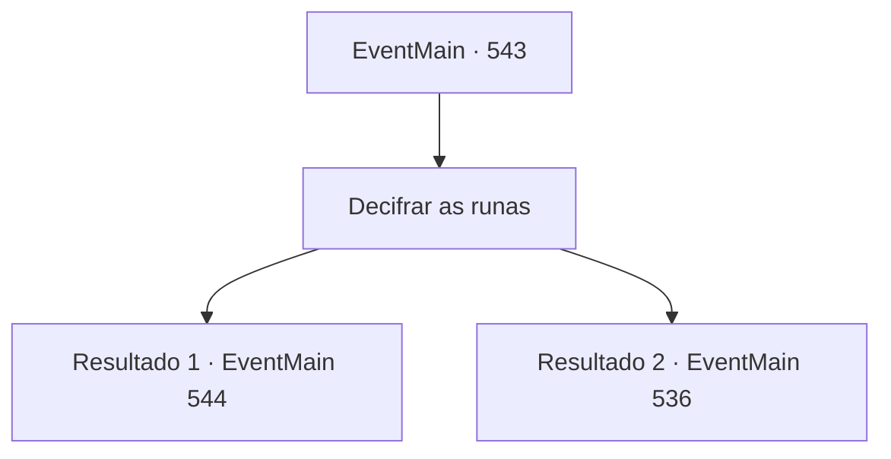

# Eventos principais · 543

[Índice da tabela](index.md) · [Índice geral](../index.md)

ID: `pt:EventMain:543` · Fonte: `EventMain4` · Versão: 1.2.47.

Mapeamento estático dos arquivos; a disponibilidade e a execução dependem do estado da run.

## Texto do evento

*Sem texto no arquivo.*

## Dados de entrada

```json
{
  "id": 543,
  "grade": 1,
  "normalGoal": "",
  "required": ""
}
```

## Mapa das escolhas



## Escolhas e resultados

### Escolha 1

Decifrar as runas

Requisitos e outros campos da escolha:

```json
{
  "required": ""
}
```

#### Resultado 1.1

Você decifra as runas na lápide lendo-as passo a passo. 'Tirar as roupas do viajante não é um vento áspero, mas um sol quente. Quente para mim também.'

Continuação registrada: [Evento 544](0544.md) na mesma tabela.

```json
{
  "required": "",
  "chance": "1|0_7_1",
  "nextEvent": 544,
  "type": 0,
  "reward": ""
}
```

#### Resultado 1.2

Você tenta decifrar as runas na lápide lendo-as passo a passo. No entanto, não importa o quanto você olhe para ela, você não consegue entender o significado do texto e, eventualmente, desiste de procurar ferramentas magias e decide implementar outros métodos.

Continuação registrada: [Evento 536](0536.md) na mesma tabela.

```json
{
  "required": "",
  "chance": "15",
  "nextEvent": 536,
  "type": 1,
  "reward": ""
}
```

## Referências que chegam a este evento

- [Evento 536 · escolha 2 · resultado 1](0536.md#escolha-2)
