# Eventos principais · 544

[Índice da tabela](index.md) · [Índice geral](../index.md)

ID: `pt:EventMain:544` · Fonte: `EventMain4` · Versão: 1.2.47.

Mapeamento estático dos arquivos; a disponibilidade e a execução dependem do estado da run.

## Texto do evento

*Sem texto no arquivo.*

## Dados de entrada

```json
{
  "id": 544,
  "grade": 1,
  "normalGoal": "",
  "required": ""
}
```

## Mapa das escolhas

```mermaid
flowchart TD
  E["EventMain · 544"]
  C0["Destruir a lápide"]
  E --> C0
  R0_0["Resultado 1 · EventMain 536"]
  C0 --> R0_0
  C1["Incendiar a lápide"]
  E --> C1
  R1_0["Resultado 1 · EventMain 536"]
  C1 --> R1_0
  C2["Cortar a árvore atrás da lápide"]
  E --> C2
  R2_0["Resultado 1 · EventMain 545"]
  C2 --> R2_0
  C3["Inscrever &#x27;calor&#x27; na lápide"]
  E --> C3
  R3_0["Resultado 1 · EventMain 536"]
  C3 --> R3_0
```



## Escolhas e resultados

### Escolha 1

Destruir a lápide

Requisitos e outros campos da escolha:

```json
{
  "required": ""
}
```

#### Resultado 1.1

Você quebra a lápide porque não consegue entender o significado do texto. Mas nada acontece depois de muito tempo e, no final, você desiste de procurar ferramentas magias e decide implementar outros métodos.

Continuação registrada: [Evento 536](0536.md) na mesma tabela.

```json
{
  "required": "",
  "chance": "1",
  "nextEvent": 536,
  "type": 2,
  "reward": ""
}
```

### Escolha 2

Incendiar a lápide

Requisitos e outros campos da escolha:

```json
{
  "required": "23_3_1"
}
```

#### Resultado 2.1

Quando solicitado a ser caloroso, você queima a lápide. Mas apenas a lápide fica enegrecida e nada acontece. Você desiste de procurar por ferramentas magias e decide implementar outros métodos.

Continuação registrada: [Evento 536](0536.md) na mesma tabela.

```json
{
  "required": "",
  "chance": "1",
  "nextEvent": 536,
  "type": 2,
  "reward": "25_3_1"
}
```

### Escolha 3

Cortar a árvore atrás da lápide

Requisitos e outros campos da escolha:

```json
{
  "required": ""
}
```

#### Resultado 3.1

Você corta a árvore que cobre a lápide. Então o sol brilha no monumento, e uma alça invisível aparece ao lado dele. 

 "Isso pode ter sido uma magia ilusória ruim."

 Com o tempo, enquanto você levanta lentamente a alça, você vê uma adega escondida sob a lápide. Dentro está um caixão que se acredita pertencer a Paella, e quando você o abre, pode ver uma chave feita de vidro limpo. 

 "Parece funcionar quando você injeta mana nele. Acho que tudo o que temos que fazer é nos livrar de Publius."

 Você guarda as chaves e instrui Gess a chamar os adoradores.

Continuação registrada: [Evento 545](0545.md) na mesma tabela.

```json
{
  "required": "",
  "chance": "1",
  "nextEvent": 545,
  "type": 2,
  "reward": "3_247_1"
}
```

### Escolha 4

Inscrever 'calor' na lápide

Requisitos e outros campos da escolha:

```json
{
  "required": ""
}
```

#### Resultado 4.1

Você grava a palavra 'calor' na lápide. Mas nada acontece depois de muito tempo, e no final, você desiste de procurar por ferramentas magias e decide implementar outros métodos.

Continuação registrada: [Evento 536](0536.md) na mesma tabela.

```json
{
  "required": "",
  "chance": "1",
  "nextEvent": 536,
  "type": 2,
  "reward": ""
}
```

## Referências que chegam a este evento

- [Evento 543 · escolha 1 · resultado 1](0543.md#escolha-1)
