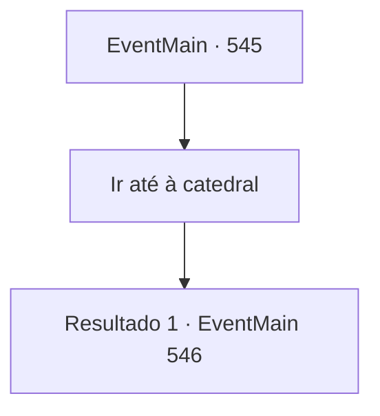

# Eventos principais · 545

[Índice da tabela](index.md) · [Índice geral](../index.md)

ID: `pt:EventMain:545` · Fonte: `EventMain4` · Versão: 1.2.47.

Mapeamento estático dos arquivos; a disponibilidade e a execução dependem do estado da run.

## Texto do evento

*Sem texto no arquivo.*

## Dados de entrada

```json
{
  "id": 545,
  "grade": 1,
  "normalGoal": "",
  "required": ""
}
```

## Mapa das escolhas



## Escolhas e resultados

### Escolha 1

Ir até à catedral

Requisitos e outros campos da escolha:

```json
{
  "required": ""
}
```

#### Resultado 1.1

|drawing_tereCathedral| Você se dirige à Catedral de Yerut com os fiéis. A catedral, que chegou logo em seguida, é um lugar esplêndido. Todo o prédio é feito de mármore, com uma cúpula azul no topo. Por toda a parede externa, há esculturas e pinturas em mosaico em homenagem aos santos de Teretian. 

 "Pare!"

 Ao se aproximar, os paladinos que guardam a catedral bloqueiam você e empunham suas espadas. Eles olham para você por um momento e, de repente, tocam a trombeta. 

 "É o demônio! O demônio está aqui!"

 Ao grito, os paladinos da catedral saem correndo.

Continuação registrada: [Evento 546](0546.md) na mesma tabela.

```json
{
  "required": "",
  "chance": "1",
  "nextEvent": 546,
  "type": 2,
  "reward": "6_0_149",
  "place": 4
}
```

## Referências que chegam a este evento

- [Evento 544 · escolha 3 · resultado 1](0544.md#escolha-3)
