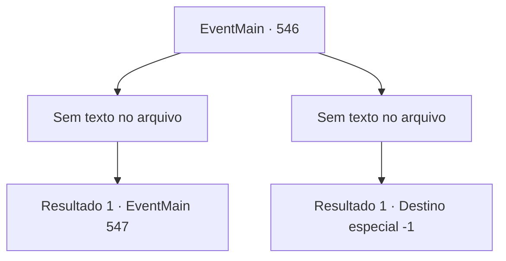

# Eventos principais · 546

[Índice da tabela](index.md) · [Índice geral](../index.md)

ID: `pt:EventMain:546` · Fonte: `EventMain4` · Versão: 1.2.47.

Mapeamento estático dos arquivos; a disponibilidade e a execução dependem do estado da run.

## Texto do evento

*Sem texto no arquivo.*

## Dados de entrada

```json
{
  "id": 546,
  "grade": 1,
  "normalGoal": "",
  "required": ""
}
```

## Mapa das escolhas



## Escolhas e resultados

### Escolha 1

*Sem texto no arquivo; o papel dessa opção depende da interface do jogo.*

Requisitos e outros campos da escolha:

```json
{
  "required": ""
}
```

#### Resultado 1.1

Você atravessa os paladinos e entra na Catedral de Yerut.  Ainda há alguns paladinos restantes, mas os adoradores os impedem.  Ao dar um passo à frente, uma forte força divina pesa em seu ombro.  Reconhecendo que a identidade do poder divino é uma barreira, você tira a chave de vidro de Paella e injeta mana.  Então o poder sagrado que pesava sobre você desaparece, e você dá mais um passo.  Naquele exato momento, de repente, uma paladina ruiva aparece, bloqueando seu caminho.  Atrás dela está um velho homem vestido com um traje vermelho sacerdotal ricamente bordado.  

 "Essa é a chave de Santa Paella... Você desenterrou a sepultura dela?"

 O velho homem olha para você como se não pudesse perdoá-lo.

Continuação registrada: [Evento 547](0547.md) na mesma tabela.

```json
{
  "required": "",
  "chance": "1",
  "nextEvent": 547,
  "type": 2,
  "reward": ""
}
```

### Escolha 2

*Sem texto no arquivo; o papel dessa opção depende da interface do jogo.*

Requisitos e outros campos da escolha:

```json
{
  "required": ""
}
```

#### Resultado 2.1

Os paladinos que guardam a catedral nem têm medo de morrer. Em vez disso, eles protegem seus colegas usando-se como escudo, e empunham uma espada contra você enquanto sangram. Seus olhos ardem de fé. Quando você está prestes a derrubar alguns dos paladinos e entrar na catedral, um caído agarra seu tornozelo. E assim que você está prestes a se livrar dele, a força contundente de outro paladino atinge sua cabeça. Uma dor violenta se espalha pela sua cabeça e você cai.

Continuação registrada: [Destino especial `-1`](../destinos-especiais.md).

```json
{
  "required": "",
  "chance": "1",
  "nextEvent": -1,
  "type": 2,
  "reward": "0_0_-1|0_1_-1|15_5_2|15_5_13"
}
```

## Referências que chegam a este evento

- [Evento 545 · escolha 1 · resultado 1](0545.md#escolha-1)
