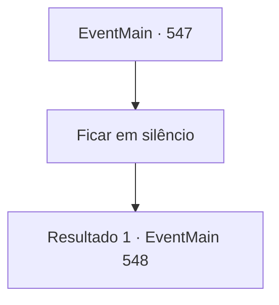

# Eventos principais · 547

[Índice da tabela](index.md) · [Índice geral](../index.md)

ID: `pt:EventMain:547` · Fonte: `EventMain4` · Versão: 1.2.47.

Mapeamento estático dos arquivos; a disponibilidade e a execução dependem do estado da run.

## Texto do evento

*Sem texto no arquivo.*

## Dados de entrada

```json
{
  "id": 547,
  "grade": 1,
  "normalGoal": "",
  "required": ""
}
```

## Mapa das escolhas



## Escolhas e resultados

### Escolha 1

Ficar em silêncio

Requisitos e outros campos da escolha:

```json
{
  "required": ""
}
```

#### Resultado 1.1

Você o encara sem responder. 

 "Valen, se livre do demônio. Eu vou cooperar."|drawing_valenWithPublius| O velho homem ordena à mulher paladina que lance magia divina. A luz de sua mão envolve seu corpo, e Valen grita, 'Sim! Arcebispo!', e corre em sua direção. Você encontra o velho homem 'Publius' ao ouvir seu grito. Logo, a espada de Valen, com um flash de luz, é direcionada a você.

Continuação registrada: [Evento 548](0548.md) na mesma tabela.

```json
{
  "required": "",
  "chance": "1",
  "nextEvent": 548,
  "type": 2,
  "reward": "6_3_148",
  "place": 4
}
```

## Referências que chegam a este evento

- [Evento 546 · escolha 1 · resultado 1](0546.md#escolha-1)
