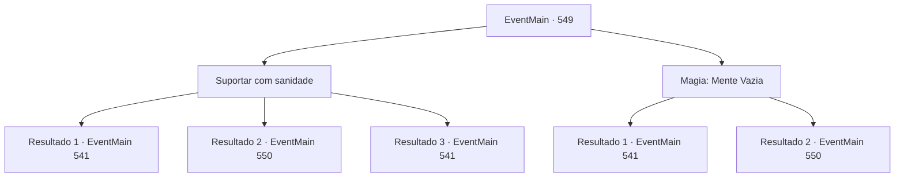

# Eventos principais · 549

[Índice da tabela](index.md) · [Índice geral](../index.md)

ID: `pt:EventMain:549` · Fonte: `EventMain4` · Versão: 1.2.47.

Mapeamento estático dos arquivos; a disponibilidade e a execução dependem do estado da run.

## Texto do evento

*Sem texto no arquivo.*

## Dados de entrada

```json
{
  "id": 549,
  "grade": 1,
  "normalGoal": "",
  "required": ""
}
```

## Mapa das escolhas



## Escolhas e resultados

### Escolha 1

Suportar com sanidade

Requisitos e outros campos da escolha:

```json
{
  "required": ""
}
```

#### Resultado 1.1

Você supera a Palavra de Poder com sua sanidade e deixa Valen sem fôlego. Quando a palavra de poder é quebrada, Publius vomita sangue como se estivesse chocado com a repulsa. 

 "Tossindo! Você... Seus pecados nunca serão perdoados por Tere!!"

 Você se aproxima de Publius sem ceder à sua maldição. E lhe dá uma morte desastrosa. Um sorriso se forma ao redor da sua boca, com o sangue dele respingando em sua bochecha. Com a morte dos dois sacerdotes, os paladinos começam a fugir em confusão. Você ordena aos adoradores que persigam e dediquem as almas de Valen e Publius a Kior. Então Kior explode em risos satisfeitos. 

 "Khahaha!!! Ótimo! É excelente! Bem, vou retribuir sua dedicação. Receba minha força. Vou te dar a força que você nunca experimentou antes."

 E então, com esse poder, Ele te ordena que apague tudo sobre Tere.

Continuação registrada: [Evento 541](0541.md) na mesma tabela.

```json
{
  "required": "24_7_1",
  "chance": "1|0_14_1",
  "nextEvent": 541,
  "type": 0,
  "reward": ""
}
```

#### Resultado 1.2

Você não consegue vencer a Palavra de Poder e acaba de joelhos. Em breve, você ouvirá a segunda palavra de poder de Publius. <b><link=shake>

 "Segure sua garganta!"

</link></b> Com essa voz, suas mãos vão para o seu pescoço.

Continuação registrada: [Evento 550](0550.md) na mesma tabela.

```json
{
  "required": "24_7_1",
  "chance": "20",
  "nextEvent": 550,
  "type": 1,
  "reward": ""
}
```

#### Resultado 1.3

Você supera a Palavra de Poder com sua sanidade e deixa Valen sem fôlego. A dominação da Palavra de Poder é fraca, graças à sua forte resistência. Quando a palavra de poder é quebrada, Publius vomita sangue como se estivesse chocado com a repulsa. 

 "Tossindo! Você... Seus pecados nunca serão perdoados por Tere!!"

 Você se aproxima de Publius sem ceder à sua maldição. E lhe dá uma morte desastrosa. Um sorriso se forma ao redor de sua boca, com seu sangue respingando em sua bochecha. Com a morte dos dois sacerdotes, os paladinos começam a fugir em confusão. Você ordena aos adoradores que persigam e dediquem as almas de Valen e Publius a Kior. Então Kior explode em risos satisfeitos. 

 "Khahaha!!! Ótimo! É excelente! Bem, vou te recompensar por sua dedicação. Receba minha força. Vou te dar a força que você nunca experimentou antes."

 E então, com esse poder, Ele te diz para apagar tudo sobre Tere.

Continuação registrada: [Evento 541](0541.md) na mesma tabela.

```json
{
  "required": "23_7_1",
  "chance": "1",
  "nextEvent": 541,
  "type": 2,
  "reward": ""
}
```

### Escolha 2

Magia: Mente Vazia

Requisitos e outros campos da escolha:

```json
{
  "required": "20_0_3|1_1_2"
}
```

#### Resultado 2.1

Você lança rapidamente Mente Vazia, então agarra o pescoço de Valen, sufocando-a. Mente Vazia bloqueia os efeitos da magia mental, e Palavra de Poder falha. Quando sua palavra de poder é quebrada, Publius vomita sangue pela força da sua resistência. 

 "Tossindo! Você... Seus pecados nunca serão perdoados por Tere!!"

 Você se aproxima de Publius, impassível diante da condenação dele. E lhe dá uma morte horrível. Um sorriso surge nos cantos da sua boca enquanto o sangue dele respinga em sua bochecha. 

 "Ótimo trabalho. {1}. Vamos, entregue-me as almas deles."

 Como Kior diz, você dedica a ele as almas dos falecidos Valen e Publius. Então Kior cai na gargalhada, satisfeito. 

 "Khahaha!!! Bom! Que excelente! Bem, vou recompensá-lo por sua dedicação. Receba minha força. Vou lhe dar um poder como você nunca experimentou antes."

 E então, com esse poder, ele lhe diz para apagar todos os vestígios de Tere.

Continuação registrada: [Evento 541](0541.md) na mesma tabela.

```json
{
  "required": "",
  "chance": "1|0_7_1|0_12_1",
  "nextEvent": 541,
  "type": 0,
  "reward": ""
}
```

#### Resultado 2.2

Para resistir à palavra de poder, você tenta usar um bloqueio mental que invalida a magia mental. No entanto, a palavra de poder tem efeito primeiro antes de você tentar o bloqueio mental. Você acaba de joelhos sem perceber, e logo vem a segunda palavra de poder de Publius. <b><link=shake>

 "Estrangular você!"

</link></b>

Continuação registrada: [Evento 550](0550.md) na mesma tabela.

```json
{
  "required": "",
  "chance": "30",
  "nextEvent": 550,
  "type": 1,
  "reward": ""
}
```

## Referências que chegam a este evento

- [Evento 548 · escolha 1 · resultado 1](0548.md#escolha-1)
