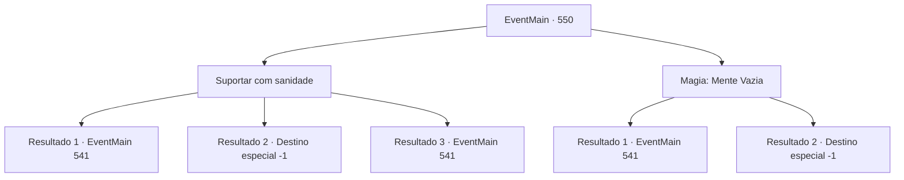

# Eventos principais · 550

[Índice da tabela](index.md) · [Índice geral](../index.md)

ID: `pt:EventMain:550` · Fonte: `EventMain4` · Versão: 1.2.47.

Mapeamento estático dos arquivos; a disponibilidade e a execução dependem do estado da run.

## Texto do evento

*Sem texto no arquivo.*

## Dados de entrada

```json
{
  "id": 550,
  "grade": 1,
  "normalGoal": "",
  "required": ""
}
```

## Mapa das escolhas



## Escolhas e resultados

### Escolha 1

Suportar com sanidade

Requisitos e outros campos da escolha:

```json
{
  "required": ""
}
```

#### Resultado 1.1

Você lança rapidamente Mente Vazia, então agarra o pescoço de Valen, sufocando-a.  Mente Vazia bloqueia os efeitos da magia mental, e Palavra de Poder falha.  Quando sua palavra de poder é quebrada, Publius vomita sangue pela força da sua resistência.  

 "Tossindo! Você... Seus pecados nunca serão perdoados por Tere!!"

  Você se aproxima de Publius, impassível diante da condenação dele.  E lhe dá uma morte horrível.  Um sorriso surge nos cantos da sua boca enquanto o sangue dele respinga em sua bochecha.  

 "Ótimo trabalho. {1}. Vamos, entregue-me as almas deles."

  Como Kior diz, você dedica a ele as almas dos falecidos Valen e Publius.  Então Kior cai na gargalhada, satisfeito.  

 "Khahaha!!! Bom! Que excelente! Bem, vou recompensá-lo por sua dedicação.  Receba minha força. Vou lhe dar um poder como você nunca experimentou antes."

  E então, com esse poder, ele lhe diz para apagar todos os vestígios de Tere.

Continuação registrada: [Evento 541](0541.md) na mesma tabela.

```json
{
  "required": "24_7_1",
  "chance": "1|0_14_1",
  "nextEvent": 541,
  "type": 0,
  "reward": ""
}
```

#### Resultado 1.2

Você não pode vencer a segunda palavra de poder, estrangule-se. Tão lentamente sua consciência começa a se turvar. Nesse momento, você pode ouvir o som de um kior estalando a língua em sua cabeça. 

 "Ah não... Estamos quase lá... Que pena..."

 No final da frase, você cai.

Continuação registrada: [Destino especial `-1`](../destinos-especiais.md).

```json
{
  "required": "24_7_1",
  "chance": "20",
  "nextEvent": -1,
  "type": 1,
  "reward": "15_5_2|15_5_13|15_5_17"
}
```

#### Resultado 1.3

Você supera Palavra de Poder com sua sanidade e agarra o pescoço de Valen, sufocando-a. O domínio de Palavra de Poder enfraquece diante da sua forte força de vontade. Quando sua palavra de poder é quebrada, Publius vomita sangue pela força da sua resistência. 

 "Tossindo! Você... Seus pecados nunca serão perdoados por Tere!!"

 Você se aproxima de Publius, impassível diante da condenação dele. E lhe dá uma morte horrível. Um sorriso surge nos cantos da sua boca enquanto o sangue dele respinga em sua bochecha. 

 "Ótimo trabalho. {1}. Vamos, entregue-me as almas deles."

 Como Kior diz, você dedica a ele as almas dos falecidos Valen e Publius. Então Kior cai na gargalhada, satisfeito. 

 "Khahaha!!! Bom! Que excelente! Bem, vou recompensá-lo por sua dedicação. Receba minha força. Vou lhe dar um poder como você nunca experimentou antes."

 E então, com esse poder, ele lhe diz para apagar todos os vestígios de Tere.

Continuação registrada: [Evento 541](0541.md) na mesma tabela.

```json
{
  "required": "23_7_1",
  "chance": "1",
  "nextEvent": 541,
  "type": 2,
  "reward": ""
}
```

### Escolha 2

Magia: Mente Vazia

Requisitos e outros campos da escolha:

```json
{
  "required": "20_0_3|1_1_2"
}
```

#### Resultado 2.1

Você lança rapidamente Mente Vazia, então agarra o pescoço de Valen, sufocando-a. Mente Vazia bloqueia os efeitos da magia mental, e Palavra de Poder falha. Quando sua palavra de poder é quebrada, Publius vomita sangue pela força da sua resistência. 

 "Tossindo! Você... Seus pecados nunca serão perdoados por Tere!!"

 Você se aproxima de Publius, impassível diante da condenação dele. E lhe dá uma morte horrível. Um sorriso surge nos cantos da sua boca enquanto o sangue dele respinga em sua bochecha. 

 "Ótimo trabalho. {1}. Vamos, entregue-me as almas deles."

 Como Kior diz, você dedica a ele as almas dos falecidos Valen e Publius. Então Kior cai na gargalhada, satisfeito. 

 "Khahaha!!! Bom! Que excelente! Bem, vou recompensá-lo por sua dedicação. Receba minha força. Vou lhe dar um poder como você nunca experimentou antes."

 E então, com esse poder, ele lhe diz para apagar todos os vestígios de Tere.

Continuação registrada: [Evento 541](0541.md) na mesma tabela.

```json
{
  "required": "",
  "chance": "1|0_7_1|0_12_1",
  "nextEvent": 541,
  "type": 0,
  "reward": ""
}
```

#### Resultado 2.2

Você tenta um bloqueio mental que invalida a magia mental, mas não consegue vencer a magia da Palavra de Poder. Suas mãos se estrangulam e lentamente sua consciência começa a se turvar. Você pode ouvir Kior clicando a língua em sua cabeça naquele momento. 

 "Ah não... Estamos quase lá... Que pena..."

 No final da frase, você cai.

Continuação registrada: [Destino especial `-1`](../destinos-especiais.md).

```json
{
  "required": "",
  "chance": "25",
  "nextEvent": -1,
  "type": 1,
  "reward": "15_5_2|15_5_13|15_5_17"
}
```

## Referências que chegam a este evento

- [Evento 549 · escolha 1 · resultado 2](0549.md#escolha-1)
- [Evento 549 · escolha 2 · resultado 2](0549.md#escolha-2)
