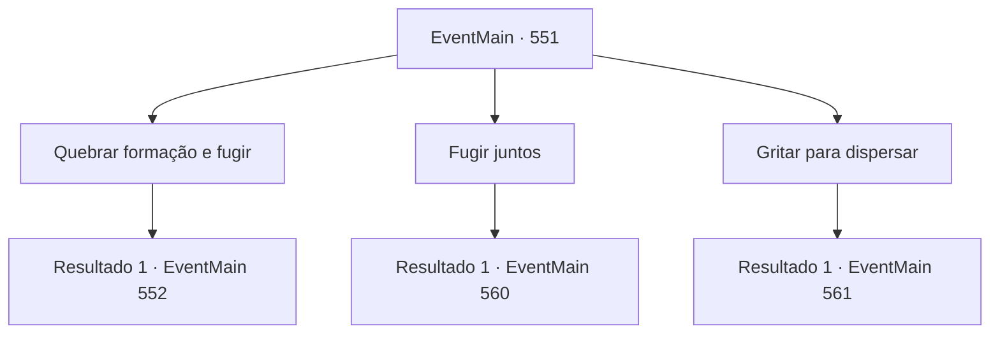

# Eventos principais · 551

[Índice da tabela](index.md) · [Índice geral](../index.md)

ID: `pt:EventMain:551` · Fonte: `EventMain4` · Versão: 1.2.47.

Mapeamento estático dos arquivos; a disponibilidade e a execução dependem do estado da run.

## Texto do evento

Você encontrou Viyork novamente em uma taverna movimentada no centro da grande cidade de 'Somi'.    Somi era um ponto estratégico, situada entre várias fronteiras, o que a tornava um centro comercial agitado.   Por isso, a cidade possuía uma mistura única de construções exóticas. Ao redor do canal que atravessava o centro da cidade, o norte era marcado por edifícios de pedra no estilo do norte, enquanto o sul exibia construções de madeira características do sul.   |drawing_viyorkInTavern|  Viyork, com um caneco de cerveja na mão, tomou um gole e murmurou em um tom baixo: 

 "De qualquer forma, parece que nossas informações chegaram a Publius. Dado o estado das coisas, só nos resta agir primeiro..."

    Enquanto você ouvia atentamente, a voz de Kior sussurrou em sua mente:   

 "...Há um perseguidor. Está observando daqui mesmo, nesta taverna. Que tolo."

    Ao ouvir isso, você lançou um olhar discreto ao redor. Próximo à entrada principal, alguns homens vestindo mantos estavam sentados, agindo de forma claramente suspeita.  

## Dados de entrada

```json
{
  "id": 551,
  "grade": 1,
  "normalGoal": "",
  "required": "1_2_75|13_4_5"
}
```

## Mapa das escolhas



## Escolhas e resultados

### Escolha 1

Quebrar formação e fugir

Requisitos e outros campos da escolha:

```json
{
  "required": ""
}
```

#### Resultado 1.1

Você informa Viyork que há perseguidores e sugere secretamente que nos espalhemos e fujamos. Ao ouvir as palavras, Viyork acena silenciosamente. 

 "Então, vamos nos encontrar no topo da colina atrás da vila."

 Então ele quebra a janela e sai correndo. Ao mesmo tempo, você pula para fora do bar como se estivesse se jogando por outra janela. 

 "Irmã Valen! Vá atrás dele! Nós iremos atrás de Viyork!"

 Nesse momento, a voz de Danica e os passos dos paladinos ressoam. Danica e os paladinos perseguem Viyork, e essa mulher de cabelos vermelhos vem atrás de você. Talvez ela seja 'Valen'.

Continuação registrada: [Evento 552](0552.md) na mesma tabela.

```json
{
  "required": "",
  "chance": "1",
  "nextEvent": 552,
  "type": 2,
  "reward": ""
}
```

### Escolha 2

Fugir juntos

Requisitos e outros campos da escolha:

```json
{
  "required": ""
}
```

#### Resultado 2.1

Você informa Viyork que há perseguidores e sugere secretamente que vamos fugir juntos. Ao ouvir as palavras, Viyork acena silenciosamente. E depois de contar, ele corre com você até a porta da frente do bar. 

 "Segurem! Não deixem eles escaparem!"

 Nesse momento, junto com a voz de Danica, os paladinos, que se disfarçaram de convidados, bloqueiam a porta da frente. Olhando ao redor, Danica, os paladinos e a mulher de cabelos vermelhos estão estreitando o cerco.

Continuação registrada: [Evento 560](0560.md) na mesma tabela.

```json
{
  "required": "",
  "chance": "1",
  "nextEvent": 560,
  "type": 2,
  "reward": ""
}
```

### Escolha 3

Gritar para dispersar

Requisitos e outros campos da escolha:

```json
{
  "required": ""
}
```

#### Resultado 3.1

Você se levanta e grita para sair. Então, os paladinos que estão disfarçados de convidados aparecem. Entre eles estão Danica, que você conheceu da última vez, e a mulher paladina, que tem cabelos vermelhos pela primeira vez. Ao ver a mulher cavaleira, Viyork mostrou uma expressão desconfortável. 

 "V, Valen...! Aquela mulher chamada Espada do Arcebispo veio atrás de nós..!"

 Uma mulher chamada Valen saca uma espada sem dizer nada e encara você e Viyork. Com aquele olhar afiado, Viyork estala a língua e coloca a mão na empunhadura da espada. Logo em seguida, ela avança e a luta começa.

Continuação registrada: [Evento 561](0561.md) na mesma tabela.

```json
{
  "required": "",
  "chance": "1",
  "nextEvent": 561,
  "type": 2,
  "reward": "6_0_148",
  "place": 4
}
```

## Referências que chegam a este evento

Nenhum `nextEvent` positivo da mesma tabela aponta para este nó. Isso não prova que seja inacessível: sorteio e estado de história podem selecioná-lo.

