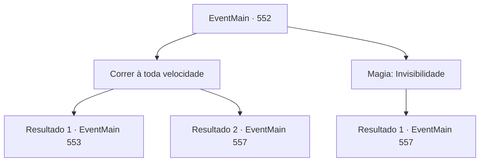

# Eventos principais · 552

[Índice da tabela](index.md) · [Índice geral](../index.md)

ID: `pt:EventMain:552` · Fonte: `EventMain4` · Versão: 1.2.47.

Mapeamento estático dos arquivos; a disponibilidade e a execução dependem do estado da run.

## Texto do evento

*Sem texto no arquivo.*

## Dados de entrada

```json
{
  "id": 552,
  "grade": 1,
  "normalGoal": "",
  "required": ""
}
```

## Mapa das escolhas



## Escolhas e resultados

### Escolha 1

Correr à toda velocidade

Requisitos e outros campos da escolha:

```json
{
  "required": ""
}
```

#### Resultado 1.1

Você corre com todas as suas forças para vencer a perseguição. Valen, a paladina de cabelos vermelhos, alcança com uma velocidade tremenda, mas felizmente, seus pés são mais rápidos que isso. Depois de uma corrida longa assim, você está completamente fora da perseguição. 

 Depois de um tempo, escondido em um prédio próximo, você respira fundo e olha para fora. Felizmente, Valen não é vista, mas o sol está se pondo. Você se lembra de um compromisso com Viyork.

Continuação registrada: [Evento 553](0553.md) na mesma tabela.

```json
{
  "required": "",
  "chance": "1|0_6_1",
  "nextEvent": 553,
  "type": 0,
  "reward": "0_2_1"
}
```

#### Resultado 1.2

Você se enfia em uma multidão aglomerada para se livrar da perseguição. Mas você acaba sendo pego pela velocidade tremenda de Valen, a paladina ruiva. Ela saca sua espada, bloqueando rapidamente seu caminho, e a batalha começa sem espaço para conversa.

Continuação registrada: [Evento 557](0557.md) na mesma tabela.

```json
{
  "required": "",
  "chance": "23",
  "nextEvent": 557,
  "type": 1,
  "reward": "6_0_148",
  "place": 4
}
```

### Escolha 2

Magia: Invisibilidade

Requisitos e outros campos da escolha:

```json
{
  "required": "20_0_2|1_1_2"
}
```

#### Resultado 2.1

Você tenta a Invisibilidade e se esconde para escapar da perseguição. Mas a paladina de cabelos vermelhos, Valen, está olhando diretamente para você. 

 "Você não pode esconder sua alma caída com um truque desses."

 Ela saca a espada, bloqueando seu caminho rapidamente.

Continuação registrada: [Evento 557](0557.md) na mesma tabela.

```json
{
  "required": "",
  "chance": "1",
  "nextEvent": 557,
  "type": 2,
  "reward": "0_1_-1|6_0_148",
  "place": 4
}
```

## Referências que chegam a este evento

- [Evento 551 · escolha 1 · resultado 1](0551.md#escolha-1)
