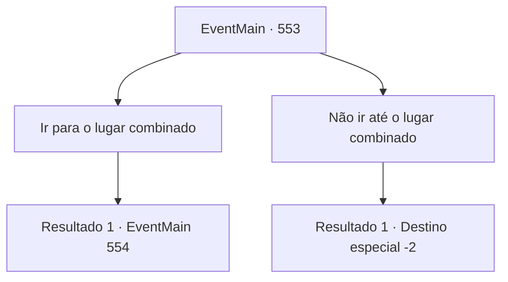

# Eventos principais · 553

[Índice da tabela](index.md) · [Índice geral](../index.md)

ID: `pt:EventMain:553` · Fonte: `EventMain4` · Versão: 1.2.47.

Mapeamento estático dos arquivos; a disponibilidade e a execução dependem do estado da run.

## Texto do evento

*Sem texto no arquivo.*

## Dados de entrada

```json
{
  "id": 553,
  "grade": 1,
  "normalGoal": "",
  "required": ""
}
```

## Mapa das escolhas



## Escolhas e resultados

### Escolha 1

Ir para o lugar combinado

Requisitos e outros campos da escolha:

```json
{
  "required": ""
}
```

#### Resultado 1.1

Depois de pensar por um tempo, você se dirigiu ao local da reunião.

 Quando o sol se põe completamente, você para de caminhar quando chega ao local da reunião. Porque não é apenas Viyork que está esperando lá. Danica, os paladinos e até Valen, que pensava que você tinha sido ostracizado, esperam por você lá. Viyork fala com o rosto inchado amarrado a uma corrente. 

 "Desculpe-me..."

 Olhando para isso, você puxa silenciosamente sua arma. Mas então, Danica fala cuidadosamente com você. 

 "Por que você não desiste? Aqui temos a espada do arcebispo, Valen, o paladino supremo de Tere."

 Ela fala com uma voz gentil e olha para a mulher de cabelos vermelhos. Valen dá um passo à frente e desembainha sua espada.

Continuação registrada: [Evento 554](0554.md) na mesma tabela.

```json
{
  "required": "",
  "chance": "1",
  "nextEvent": 554,
  "type": 2,
  "reward": ""
}
```

### Escolha 2

Não ir até o lugar combinado

Requisitos e outros campos da escolha:

```json
{
  "required": ""
}
```

#### Resultado 2.1

Você decide não ir para o local da reunião. Kior sussurra que você pensa bem. 

 "Talvez Viyork já tenha sido pego... Por que você não revisita meus adoradores? Tenho certeza de que eles ajudarão muito mais do que Viyork."

 Kior reitera o fato de que eles estão na vila de Kahida. Após pensar, você segue suas palavras e se move para Kahida.

Continuação registrada: [Destino especial `-2`](../destinos-especiais.md).

```json
{
  "required": "",
  "chance": "1",
  "nextEvent": -2,
  "type": 2,
  "reward": "13_4_17"
}
```

## Referências que chegam a este evento

- [Evento 552 · escolha 1 · resultado 1](0552.md#escolha-1)
