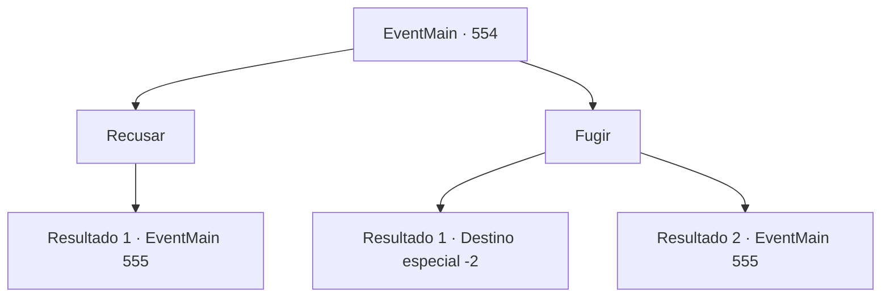

# Eventos principais · 554

[Índice da tabela](index.md) · [Índice geral](../index.md)

ID: `pt:EventMain:554` · Fonte: `EventMain4` · Versão: 1.2.47.

Mapeamento estático dos arquivos; a disponibilidade e a execução dependem do estado da run.

## Texto do evento

*Sem texto no arquivo.*

## Dados de entrada

```json
{
  "id": 554,
  "grade": 1,
  "normalGoal": "",
  "required": ""
}
```

## Mapa das escolhas



## Escolhas e resultados

### Escolha 1

Recusar

Requisitos e outros campos da escolha:

```json
{
  "required": ""
}
```

#### Resultado 1.1

Você corre em direção a Valen e aos paladinos, dizendo a Danica para não ser ridícula. Mesmo em um ataque surpresa repentino, eles revidam calmamente como se estivessem esperando.

Continuação registrada: [Evento 555](0555.md) na mesma tabela.

```json
{
  "required": "",
  "chance": "1",
  "nextEvent": 555,
  "type": 2,
  "reward": "6_3_50",
  "place": 1
}
```

### Escolha 2

Fugir

Requisitos e outros campos da escolha:

```json
{
  "required": ""
}
```

#### Resultado 2.1

Você foge rapidamente dali em vez de responder. Os paladinos correm atrás de você, mas não conseguem te pegar escondido na escuridão da noite. Depois de se livrar da perseguição novamente, você se esconde no meio da colina. Então, Kior sussurra. 

 "Hmm... A situação se tornou difícil. Por que você não revisita meus adoradores? Tenho certeza de que eles ajudarão muito mais do que o capturado Viyork."

 Kior reitera o fato de que eles estão na vila de Kahida. Depois de pensar, você segue suas palavras e se muda para Kahida.

Continuação registrada: [Destino especial `-2`](../destinos-especiais.md).

```json
{
  "required": "",
  "chance": "1|0_6_1",
  "nextEvent": -2,
  "type": 0,
  "reward": "13_4_17"
}
```

#### Resultado 2.2

Você tenta escapar dali rapidamente em vez de responder. Mas eles te cercam instantaneamente como se soubessem o que você faria. 

 "Nenhum mal pode escapar dos servos de Tere."

 Quando Valen aponta sua espada para você, o ataque dos paladinos começa.

Continuação registrada: [Evento 555](0555.md) na mesma tabela.

```json
{
  "required": "",
  "chance": "20",
  "nextEvent": 555,
  "type": 1,
  "reward": "6_3_50",
  "place": 1
}
```

## Referências que chegam a este evento

- [Evento 553 · escolha 1 · resultado 1](0553.md#escolha-1)
