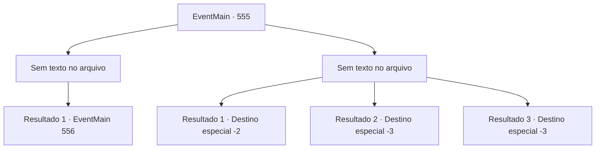

# Eventos principais · 555

[Índice da tabela](index.md) · [Índice geral](../index.md)

ID: `pt:EventMain:555` · Fonte: `EventMain4` · Versão: 1.2.47.

Mapeamento estático dos arquivos; a disponibilidade e a execução dependem do estado da run.

## Texto do evento

*Sem texto no arquivo.*

## Dados de entrada

```json
{
  "id": 555,
  "grade": 1,
  "normalGoal": "",
  "required": ""
}
```

## Mapa das escolhas



## Escolhas e resultados

### Escolha 1

*Sem texto no arquivo; o papel dessa opção depende da interface do jogo.*

Requisitos e outros campos da escolha:

```json
{
  "required": ""
}
```

#### Resultado 1.1

Após uma batalha feroz, você derruba todos os paladinos ao seu redor.  Mas sem descanso, Valen corre em sua direção com sua espada erguida.  Você rapidamente bloqueia a espada de Valen e contra-ataca.

Continuação registrada: [Evento 556](0556.md) na mesma tabela.

```json
{
  "required": "",
  "chance": "1",
  "nextEvent": 556,
  "type": 2,
  "reward": "6_0_148",
  "place": 1
}
```

### Escolha 2

*Sem texto no arquivo; o papel dessa opção depende da interface do jogo.*

Requisitos e outros campos da escolha:

```json
{
  "required": ""
}
```

#### Resultado 2.1

Olhando para trás, você vê um rio fluindo fortemente sob um penhasco remoto. Você foi encurralado pelos paladinos. Após um momento de conflito, você pula do penhasco como está. Quando você pula no rio agitado, o rio atinge seu nariz e boca. Cheira a peixe e água. 

 De manhã, você acorda depois de ser arrastado pelo rio. Você levanta seu corpo cuspindo água com uma tosse. E Kior sussurra para você. 

 "Hmm... A situação se tornou difícil. Por que você não visita meus adoradores novamente? Tenho certeza de que eles ajudarão muito mais do que Viyork capturado."

 Kior reitera o fato de que eles estão na vila de Kahida. Depois de espremer a água das roupas molhadas, você decide visitar Kahida de acordo com suas palavras.

Continuação registrada: [Destino especial `-2`](../destinos-especiais.md).

```json
{
  "required": "1_0_2|1_1_2",
  "chance": "1",
  "nextEvent": -2,
  "type": 2,
  "reward": "0_0_-1|0_1_-1|13_4_17"
}
```

#### Resultado 2.2

Olhando para trás, você vê um rio fluindo fortemente sob um penhasco remoto. Você foi encurralado pelos paladinos. Após um momento de conflito, você pula do penhasco como está. Quando você pula no rio turbulento, o rio atinge seu nariz e boca. E você está perdendo a consciência.

Continuação registrada: [Destino especial `-3`](../destinos-especiais.md).

```json
{
  "required": "2_0_2",
  "chance": "1",
  "nextEvent": -3,
  "type": 2,
  "reward": "0_0_-1|0_1_-1"
}
```

#### Resultado 2.3

Olhando para trás, você vê um rio fluindo fortemente sob um penhasco remoto. Você foi encurralado pelos paladinos. Após um momento de conflito, você pula do penhasco como está. Quando você pula no rio turbulento, o rio atinge seu nariz e boca. E você está perdendo a consciência.

Continuação registrada: [Destino especial `-3`](../destinos-especiais.md).

```json
{
  "required": "2_1_2",
  "chance": "1",
  "nextEvent": -3,
  "type": 2,
  "reward": "0_0_-1|0_1_-1"
}
```

## Referências que chegam a este evento

- [Evento 554 · escolha 1 · resultado 1](0554.md#escolha-1)
- [Evento 554 · escolha 2 · resultado 2](0554.md#escolha-2)
