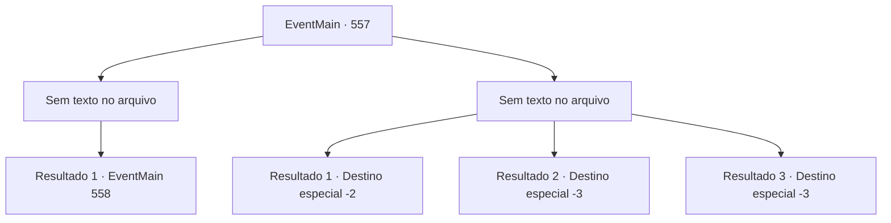

# Eventos principais · 557

[Índice da tabela](index.md) · [Índice geral](../index.md)

ID: `pt:EventMain:557` · Fonte: `EventMain4` · Versão: 1.2.47.

Mapeamento estático dos arquivos; a disponibilidade e a execução dependem do estado da run.

## Texto do evento

*Sem texto no arquivo.*

## Dados de entrada

```json
{
  "id": 557,
  "grade": 1,
  "normalGoal": "",
  "required": ""
}
```

## Mapa das escolhas



## Escolhas e resultados

### Escolha 1

*Sem texto no arquivo; o papel dessa opção depende da interface do jogo.*

Requisitos e outros campos da escolha:

```json
{
  "required": ""
}
```

#### Resultado 1.1

Você rebate a espada de Valen e a chuta. O vento faz Valen cair no chão, e você fica em cima dela e levanta sua arma. E naquele exato momento. A voz de Danica ao longe te impede. 

 "Pare! Você não sente pena pela vida de sua colega?"

 Ao virar a cabeça, você vê Viyork ao lado dela, acorrentado. Danica fala com você em voz urgente. 

 "Vamos fazer um acordo. Eu entregarei Viyork, então por favor entregue a Irmã Valen."

 Então o som da risada de Kior se espalha em sua cabeça. 

 "Haha. Olhe para essa coisa má. É realmente como o sacerdote de 'Tere, o deus da justiça e disciplina."


Continuação registrada: [Evento 558](0558.md) na mesma tabela.

```json
{
  "required": "",
  "chance": "1",
  "nextEvent": 558,
  "type": 2,
  "reward": ""
}
```

### Escolha 2

*Sem texto no arquivo; o papel dessa opção depende da interface do jogo.*

Requisitos e outros campos da escolha:

```json
{
  "required": ""
}
```

#### Resultado 2.1

Você está gradualmente sendo levado para um beco sem saída. Então você se joga na multidão novamente. 

 "Pare aí!"

 Valen te persegue em um ritmo assustador. Você está prestes a ser alcançado, mas consegue escapar. Ela perdeu o momento do ataque graças à intervenção repentina da carruagem e das crianças do outro lado da rua. Depois de salvar sua vida por pouco, você deixa a cidade para escapar de Valen. Nesse momento, Kior sussurra de repente. 

 "Talvez Viyork já tenha sido capturado... Por que você não visita meus adoradores? Tenho certeza de que eles ajudarão muito mais do que Viyork."

 Kior reitera o fato de que eles estão na vila de Kahida. Após pensar, você segue suas palavras e se muda para Kahida.

Continuação registrada: [Destino especial `-2`](../destinos-especiais.md).

```json
{
  "required": "1_0_2|1_1_2",
  "chance": "1",
  "nextEvent": -2,
  "type": 2,
  "reward": "0_0_-1|0_1_-1|13_4_17"
}
```

#### Resultado 2.2

A espada impiedosa de Valen perfura seu peito como um raio. Naquela terrível dor, você nem consegue gritar e morre.

Continuação registrada: [Destino especial `-3`](../destinos-especiais.md).

```json
{
  "required": "2_0_2",
  "chance": "1",
  "nextEvent": -3,
  "type": 2,
  "reward": "0_0_-1|0_1_-1"
}
```

#### Resultado 2.3

A espada impiedosa de Valen perfura seu peito como um raio. Naquela terrível dor, você nem consegue gritar e morre.

Continuação registrada: [Destino especial `-3`](../destinos-especiais.md).

```json
{
  "required": "2_1_2",
  "chance": "1",
  "nextEvent": -3,
  "type": 2,
  "reward": "0_0_-1|0_1_-1"
}
```

## Referências que chegam a este evento

- [Evento 552 · escolha 1 · resultado 2](0552.md#escolha-1)
- [Evento 552 · escolha 2 · resultado 1](0552.md#escolha-2)
