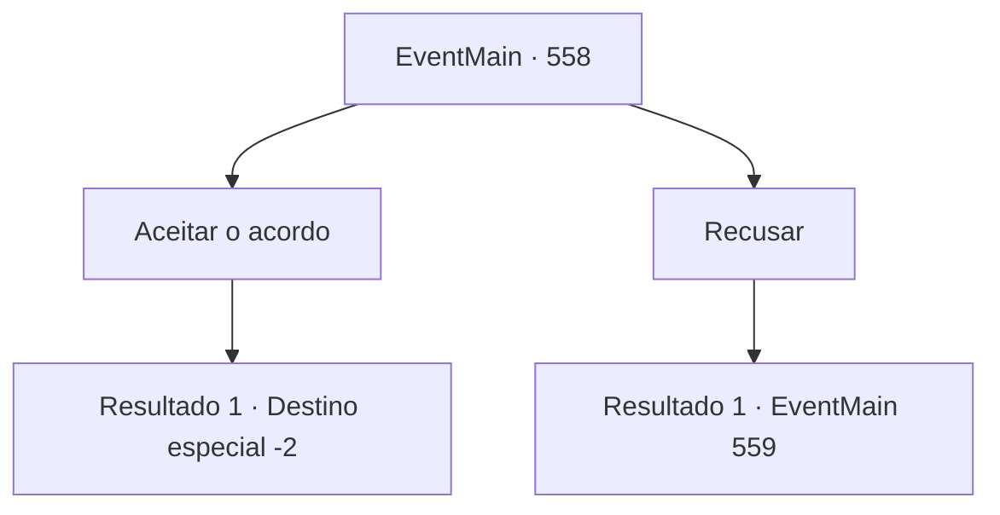

# Eventos principais · 558

[Índice da tabela](index.md) · [Índice geral](../index.md)

ID: `pt:EventMain:558` · Fonte: `EventMain4` · Versão: 1.2.47.

Mapeamento estático dos arquivos; a disponibilidade e a execução dependem do estado da run.

## Texto do evento

*Sem texto no arquivo.*

## Dados de entrada

```json
{
  "id": 558,
  "grade": 1,
  "normalGoal": "",
  "required": ""
}
```

## Mapa das escolhas



## Escolhas e resultados

### Escolha 1

Aceitar o acordo

Requisitos e outros campos da escolha:

```json
{
  "required": ""
}
```

#### Resultado 1.1

Você aceita o acordo com ela. Você e Danica, que seguram o refém, olham um para o outro à distância e enviam o refém na direção oposta de acordo com o sinal. Felizmente, os paladinos não atacam até que a troca de reféns termine. Viyork, que logo conseguiu voltar até você, diz com voz trêmula. 

 "O-obrigado, mas eles virão atrás! Vamos sair daqui."

 Conforme ele diz, logo após a troca de reféns, os paladinos começam a perseguir novamente. Viyork grita, fugindo em uma direção diferente da sua. 

 "Eu te ligo mais tarde! Até lá!"

 Você acena com a cabeça para as palavras de Viyork e se apressa para fugir.

Continuação registrada: [Destino especial `-2`](../destinos-especiais.md).

```json
{
  "required": "",
  "chance": "1",
  "nextEvent": -2,
  "type": 2,
  "reward": "13_4_16"
}
```

### Escolha 2

Recusar

Requisitos e outros campos da escolha:

```json
{
  "required": ""
}
```

#### Resultado 2.1

Você recusa a oferta e levanta a arma novamente. Mas antes de tirar o fôlego de Valen, o feitiço sagrado dos paladinos. Você dá um passo para trás diante da flecha repentina de luz e olha para os paladinos. 

 "Coloque a prioridade em salvar a Irmã Valen!"

 Enquanto isso, os paladinos, comandados por Danica, estão correndo em sua direção. Você decide lidar com eles primeiro e pegar em armas.

Continuação registrada: [Evento 559](0559.md) na mesma tabela.

```json
{
  "required": "",
  "chance": "1",
  "nextEvent": 559,
  "type": 2,
  "reward": "6_0_50",
  "place": 1
}
```

## Referências que chegam a este evento

- [Evento 557 · escolha 1 · resultado 1](0557.md#escolha-1)
