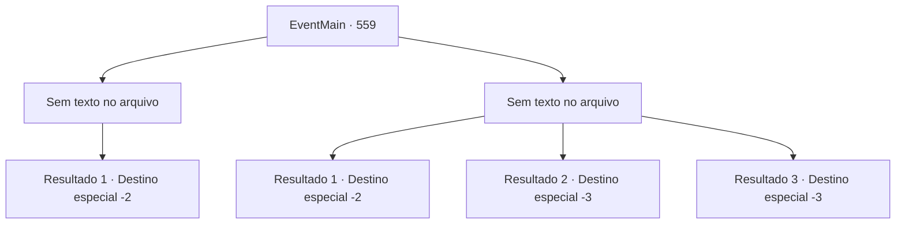

# Eventos principais · 559

[Índice da tabela](index.md) · [Índice geral](../index.md)

ID: `pt:EventMain:559` · Fonte: `EventMain4` · Versão: 1.2.47.

Mapeamento estático dos arquivos; a disponibilidade e a execução dependem do estado da run.

## Texto do evento

*Sem texto no arquivo.*

## Dados de entrada

```json
{
  "id": 559,
  "grade": 1,
  "normalGoal": "",
  "required": ""
}
```

## Mapa das escolhas



## Escolhas e resultados

### Escolha 1

*Sem texto no arquivo; o papel dessa opção depende da interface do jogo.*

Requisitos e outros campos da escolha:

```json
{
  "required": ""
}
```

#### Resultado 1.1

Você derruba todos os paladinos que vêm até você e tira a vida de Valen. Nesse momento, o grito urgente de Viyork é ouvido. 

 "Depressa! Danica também!"

 Virando seus olhos, você vê Viyork amarrado segurando o tornozelo de Danica. Pensando que ela poderia fugir novamente, você corre para Danica. Danica consegue se livrar de Viyork e foge antes de tropeçar na raiz de uma árvore. 

 "O... Oh, meu, Tere..."

 Mesmo em seu chamado lamentoso, o deus em que ela acredita não tem resposta. Depois de respirar seu último suspiro, você solta Viyork acorrentado. 

 "Haha! Eu pensei que estava tudo acabado quando fui pego... Mas mesmo assim você mata Valen e Danica!"

 Viyork discute, dizendo que matar Publius, que perdeu todas as mãos e pés, é moleza. Você dedica as almas dos paladinos ao Kior. E sai de lá prometendo encontrar Viyork novamente da próxima vez.

Continuação registrada: [Destino especial `-2`](../destinos-especiais.md).

```json
{
  "required": "",
  "chance": "1",
  "nextEvent": -2,
  "type": 2,
  "reward": "13_4_24"
}
```

### Escolha 2

*Sem texto no arquivo; o papel dessa opção depende da interface do jogo.*

Requisitos e outros campos da escolha:

```json
{
  "required": ""
}
```

#### Resultado 2.1

Quando você ataca uma vez, dez contra-ataques voltam. Tudo o que você pode fazer diante da violência avassaladora da maioria é fugir.

 Depois de um tempo, você, que conseguiu fugir, se esconde em uma fenda na rocha e recupera o fôlego. E Kior sussurra para você. 

 "Hmm... Por que você não visita meus adoradores novamente? Tenho certeza de que eles ajudarão muito mais do que Viyork capturado."

 Kior reitera o fato de que eles estão na vila de Kahida. Depois de espremer a água das roupas molhadas, você decide visitar Kahida de acordo com suas palavras.

Continuação registrada: [Destino especial `-2`](../destinos-especiais.md).

```json
{
  "required": "1_0_2|1_1_2",
  "chance": "1",
  "nextEvent": -2,
  "type": 2,
  "reward": "0_0_-1|0_1_-1|13_4_17"
}
```

#### Resultado 2.2

Quando você ataca uma vez, dez contra-ataques retornam. Tudo o que você pode fazer diante da esmagadora violência da maioria é fugir. Mas os paladinos ao seu redor nem mesmo permitem isso. Por fim, você é esfaqueado até a morte por inúmeras espadas.

Continuação registrada: [Destino especial `-3`](../destinos-especiais.md).

```json
{
  "required": "2_0_2",
  "chance": "1",
  "nextEvent": -3,
  "type": 2,
  "reward": "0_0_-1|0_1_-1"
}
```

#### Resultado 2.3

Quando você ataca uma vez, dez contra-ataques retornam. Tudo o que você pode fazer diante da esmagadora violência da maioria é fugir. Mas os paladinos ao seu redor nem mesmo permitem isso. Por fim, você é esfaqueado até a morte por inúmeras espadas.

Continuação registrada: [Destino especial `-3`](../destinos-especiais.md).

```json
{
  "required": "2_1_2",
  "chance": "1",
  "nextEvent": -3,
  "type": 2,
  "reward": "0_0_-1|0_1_-1"
}
```

## Referências que chegam a este evento

- [Evento 558 · escolha 2 · resultado 1](0558.md#escolha-2)
