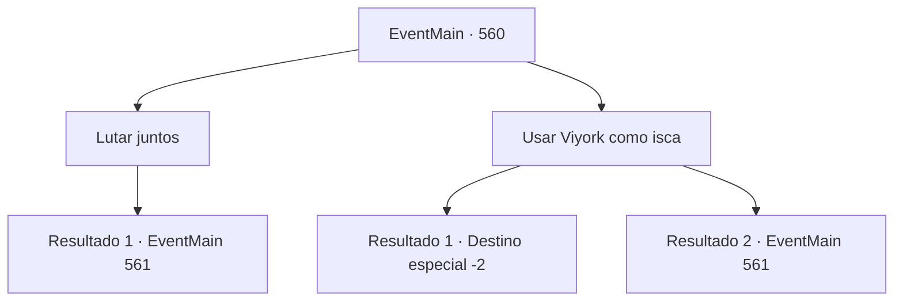

# Eventos principais · 560

[Índice da tabela](index.md) · [Índice geral](../index.md)

ID: `pt:EventMain:560` · Fonte: `EventMain4` · Versão: 1.2.47.

Mapeamento estático dos arquivos; a disponibilidade e a execução dependem do estado da run.

## Texto do evento

*Sem texto no arquivo.*

## Dados de entrada

```json
{
  "id": 560,
  "grade": 1,
  "normalGoal": "",
  "required": ""
}
```

## Mapa das escolhas



## Escolhas e resultados

### Escolha 1

Lutar juntos

Requisitos e outros campos da escolha:

```json
{
  "required": ""
}
```

#### Resultado 1.1

Você rapidamente coloca as costas contra Viyork e saca sua arma. Imediatamente após isso, os ataques de Valen e dos paladinos são direcionados a você e Viyork.

Continuação registrada: [Evento 561](0561.md) na mesma tabela.

```json
{
  "required": "",
  "chance": "1",
  "nextEvent": 561,
  "type": 2,
  "reward": "6_0_148",
  "place": 4
}
```

### Escolha 2

Usar Viyork como isca

Requisitos e outros campos da escolha:

```json
{
  "required": "5_379_0"
}
```

#### Resultado 2.1

Você empurra Viyork pelas costas. De repente, Viyork, que é empurrado para trás, cai alto com sua espada, e nesse momento, os olhos dos paladinos se voltam para ele. Você aproveita a oportunidade e foge deles. Alguns deles te perseguem tarde, mas você se esconde na multidão e foge em segurança. De repente, Kior sussurra em sua cabeça. 

 "Tenho certeza de que Viyork foi pego... Se você está preocupado com para onde ir, por que não revisitar meus adoradores? Eles serão muito mais úteis do que Viyork."

 Kior reitera o fato de que eles estão na vila de Kahida. Você decide visitar Kahida de acordo com suas palavras.

Continuação registrada: [Destino especial `-2`](../destinos-especiais.md).

```json
{
  "required": "",
  "chance": "1|0_5_1",
  "nextEvent": -2,
  "type": 0,
  "reward": "13_4_17"
}
```

#### Resultado 2.2

Você empurra Viyork pelas costas. Mas talvez sua força esteja faltando. Viyork apenas tropeça e não cai. 

 "O que, o que você está fazendo agora?"

 Viyork fica corado e grita, mas ele não te interroga mais, talvez por causa da situação. Com o tempo, você tira suas armas com as costas de Viyork, então Valen e os paladinos atacam.

Continuação registrada: [Evento 561](0561.md) na mesma tabela.

```json
{
  "required": "",
  "chance": "13",
  "nextEvent": 561,
  "type": 1,
  "reward": "5_379_1|6_0_148",
  "place": 4
}
```

## Referências que chegam a este evento

- [Evento 551 · escolha 2 · resultado 1](0551.md#escolha-2)
