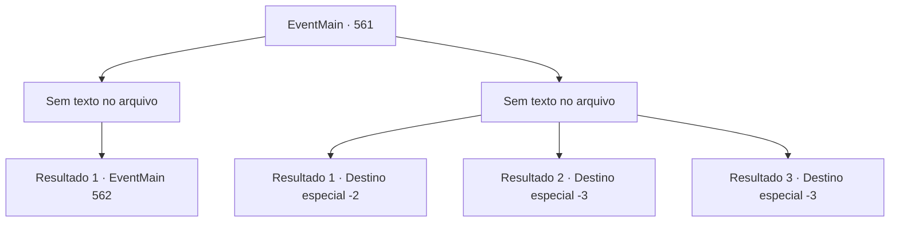

# Eventos principais · 561

[Índice da tabela](index.md) · [Índice geral](../index.md)

ID: `pt:EventMain:561` · Fonte: `EventMain4` · Versão: 1.2.47.

Mapeamento estático dos arquivos; a disponibilidade e a execução dependem do estado da run.

## Texto do evento

*Sem texto no arquivo.*

## Dados de entrada

```json
{
  "id": 561,
  "grade": 1,
  "normalGoal": "",
  "required": ""
}
```

## Mapa das escolhas



## Escolhas e resultados

### Escolha 1

*Sem texto no arquivo; o papel dessa opção depende da interface do jogo.*

Requisitos e outros campos da escolha:

```json
{
  "required": ""
}
```

#### Resultado 1.1

Enquanto Viyork lidava com outros paladinos, você teve uma batalha feroz com Valen. E a luta termina quando você a apunhala no coração. 

 "Kuh... meu Deus..."

 Valen olha para sua espada que a penetrou com olhos incrédulos. E sangue vermelho brilhante jorra de sua boca. Você passa pela caída Valen e segue em direção a Viyork. Enquanto isso, Viyork está matando todos os paladinos e estrangulando Danica. Danica luta para resistir, mas não dura muito tempo. 

 "Hu... Parece que você se livrou de Valen. Você fez um ótimo trabalho."


Continuação registrada: [Evento 562](0562.md) na mesma tabela.

```json
{
  "required": "",
  "chance": "1",
  "nextEvent": 562,
  "type": 2,
  "reward": ""
}
```

### Escolha 2

*Sem texto no arquivo; o papel dessa opção depende da interface do jogo.*

Requisitos e outros campos da escolha:

```json
{
  "required": ""
}
```

#### Resultado 2.1

Os esforços desesperados de Viyork estão atraindo a atenção dos paladinos. Percebendo que você não pode vencer, você foge deles enquanto seus olhos estão em Viyork. Alguns deles vêm atrás de você pelas suas costas, mas não conseguem te pegar.

 Depois de um tempo, você respira fundo e olha ao redor. Nesse momento, Kior sussurra. 

 "Você está em perigo {1}. Por que você não revisita meus adoradores? Eles serão muito mais úteis do que Viyork."

 Kior reitera o fato de que eles estão na vila de Kahida. Você decide visitar Kahida de acordo com suas palavras.

Continuação registrada: [Destino especial `-2`](../destinos-especiais.md).

```json
{
  "required": "1_0_2|1_1_2",
  "chance": "1",
  "nextEvent": -2,
  "type": 2,
  "reward": "0_0_-1|0_1_-1|13_4_17"
}
```

#### Resultado 2.2

A espada de Valen corta a cabeça de Viyork e se dirige a você.  Você quer evitar a lâmina, mas não pode porque os paladinos bloqueiam o caminho para escapar.  A espada que ela empunhava corta sua carne.  E você sente o mundo inclinar e cai no chão.

Continuação registrada: [Destino especial `-3`](../destinos-especiais.md).

```json
{
  "required": "2_0_2",
  "chance": "1",
  "nextEvent": -3,
  "type": 2,
  "reward": "0_0_-1|0_1_-1"
}
```

#### Resultado 2.3

A espada de Valen corta a cabeça de Viyork e se dirige a você.  Você quer evitar a lâmina, mas não pode porque os paladinos bloqueiam o caminho para escapar.  A espada que ela empunhava corta sua carne.  E você sente o mundo inclinar e cai no chão.

Continuação registrada: [Destino especial `-3`](../destinos-especiais.md).

```json
{
  "required": "2_1_2",
  "chance": "1",
  "nextEvent": -3,
  "type": 2,
  "reward": "0_0_-1|0_1_-1"
}
```

## Referências que chegam a este evento

- [Evento 551 · escolha 3 · resultado 1](0551.md#escolha-3)
- [Evento 560 · escolha 1 · resultado 1](0560.md#escolha-1)
- [Evento 560 · escolha 2 · resultado 2](0560.md#escolha-2)
