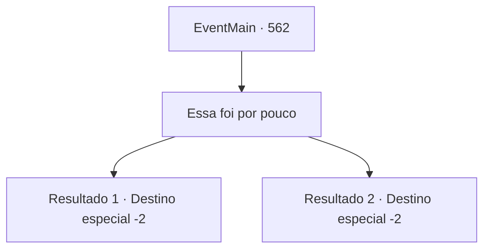

# Eventos principais · 562

[Índice da tabela](index.md) · [Índice geral](../index.md)

ID: `pt:EventMain:562` · Fonte: `EventMain4` · Versão: 1.2.47.

Mapeamento estático dos arquivos; a disponibilidade e a execução dependem do estado da run.

## Texto do evento

*Sem texto no arquivo.*

## Dados de entrada

```json
{
  "id": 562,
  "grade": 1,
  "normalGoal": "",
  "required": ""
}
```

## Mapa das escolhas



## Escolhas e resultados

### Escolha 1

Essa foi por pouco

Requisitos e outros campos da escolha:

```json
{
  "required": ""
}
```

#### Resultado 1.1

Você se aproxima dele, dizendo que foi perigoso. Em resposta, Viyork assente com a cabeça e olha para você com um olhar desconfortável. 

 "Sim, foi perigoso. Ainda mais porque você tentou me provocar."

 Ele olha para você com olhos desconfortáveis e se levanta com um suspiro. E ele limpa o sangue das mãos e fala com uma voz gentil. 

 "Mas eu vou te perdoar por se livrar de Valen. Tudo o que precisamos fazer é matar Publius, então não precisamos ficar com raiva um do outro. Certo?"

 Viyork dá tapinhas no seu ombro e de repente lhe dá um sorriso generoso. Você dedica as almas dos paladinos a Kior e então sai de lá, prometendo encontrar Viyork novamente da próxima vez.

Continuação registrada: [Destino especial `-2`](../destinos-especiais.md).

```json
{
  "required": "5_379_1",
  "chance": "1",
  "nextEvent": -2,
  "type": 2,
  "reward": "13_4_11"
}
```

#### Resultado 1.2

Você se aproxima dele, dizendo que foi perigoso. Em resposta, Viyork acena com a cabeça e se levanta cambaleando. 

 "Foi um pouco perigoso, mas agora que matamos Valen e Danica, só nos resta Publius."

 Viyork te dá um tapinha no ombro e sorri. Você dedica as almas dos paladinos a Kior e então sai de lá, prometendo encontrar Viyork novamente da próxima vez.

Continuação registrada: [Destino especial `-2`](../destinos-especiais.md).

```json
{
  "required": "18_379_1",
  "chance": "1",
  "nextEvent": -2,
  "type": 2,
  "reward": "13_4_24"
}
```

## Referências que chegam a este evento

- [Evento 561 · escolha 1 · resultado 1](0561.md#escolha-1)
