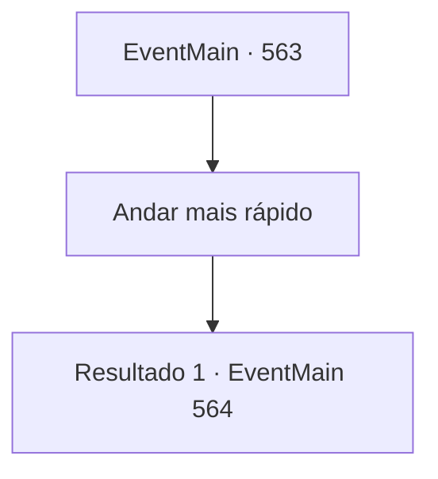

# Eventos principais · 563

[Índice da tabela](index.md) · [Índice geral](../index.md)

ID: `pt:EventMain:563` · Fonte: `EventMain4` · Versão: 1.2.47.

Mapeamento estático dos arquivos; a disponibilidade e a execução dependem do estado da run.

## Texto do evento

Você estava a caminho da vila de Kahida para se encontrar com os cultistas, quando vozes animadas vindas do rio chamaram sua atenção. 

 "Você ouviu? Aquele tal de Viyork, o paladino, morreu queimado dias atrás..."

 Olhando para a margem do rio, você viu algumas mulheres lavando roupas enquanto conversavam animadamente. Elas fofocavam sobre Viyork ter supostamente feito um pacto com demônios e como a Igreja de Tere estava intensificando suas ações para erradicar os adoradores infernais. Enquanto você ouvia em silêncio, Kior sussurrou em sua mente com uma voz grave: 

 "Precisamos agir rápido... A execução de Viyork é apenas o começo, e os movimentos da Igreja de Tere não parecem nada bons..."


## Dados de entrada

```json
{
  "id": 563,
  "grade": 1,
  "normalGoal": "",
  "required": "1_2_100|13_4_17"
}
```

## Mapa das escolhas



## Escolhas e resultados

### Escolha 1

Andar mais rápido

Requisitos e outros campos da escolha:

```json
{
  "required": ""
}
```

#### Resultado 1.1

Você se apressou para a vila de Kahida, aceitando as palavras de Kior. 

 Dois dias depois,  

 "Capture todos! Não os deixe escapar!"

 Ao chegar na Vila de Kahida, você saca sua arma. Isso porque Danica e os paladinos estão atacando Kahida. Os adoradores de demônios estão caindo impotentes sob o ataque dos paladinos. 

 "Oh! Isso é...!"

 Danica rapidamente reconhece você e ordena que os paladinos ataquem. Você dá força às suas mãos ao ver os paladinos correndo.

Continuação registrada: [Evento 564](0564.md) na mesma tabela.

```json
{
  "required": "",
  "chance": "1",
  "nextEvent": 564,
  "type": 2,
  "reward": "6_3_50",
  "place": 4
}
```

## Referências que chegam a este evento

Nenhum `nextEvent` positivo da mesma tabela aponta para este nó. Isso não prova que seja inacessível: sorteio e estado de história podem selecioná-lo.

