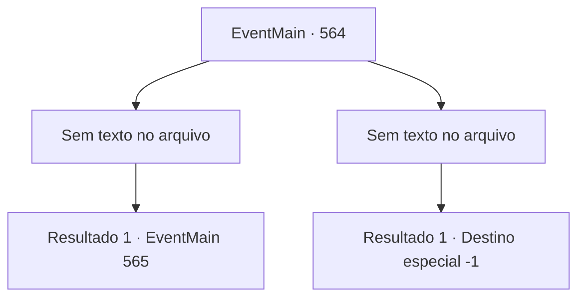

# Eventos principais · 564

[Índice da tabela](index.md) · [Índice geral](../index.md)

ID: `pt:EventMain:564` · Fonte: `EventMain4` · Versão: 1.2.47.

Mapeamento estático dos arquivos; a disponibilidade e a execução dependem do estado da run.

## Texto do evento

*Sem texto no arquivo.*

## Dados de entrada

```json
{
  "id": 564,
  "grade": 1,
  "normalGoal": "",
  "required": ""
}
```

## Mapa das escolhas



## Escolhas e resultados

### Escolha 1

*Sem texto no arquivo; o papel dessa opção depende da interface do jogo.*

Requisitos e outros campos da escolha:

```json
{
  "required": ""
}
```

#### Resultado 1.1

Você retira todas as almas dos paladinos e olha ao redor. Enquanto você lida com eles, adoradores de demônios parecem ter capturado Danica. Os adoradores de demônios a arrastam na sua frente e se ajoelham com uma mordaça em sua boca. E o homem na frente deles se curva e expressa sua gratidão. 

 "G, Gra, Grande Co, contratante... Você salvou nossas vi, vidas humildes. Eu, Gess ap, agradeço em nosso nome."|drawing_gess| Gess tem cabelos brancos, suas gengivas estão colapsadas e seus olhos estão turvos. Mas sua expressão está cheia de convicção.

Continuação registrada: [Evento 565](0565.md) na mesma tabela.

```json
{
  "required": "",
  "chance": "1",
  "nextEvent": 565,
  "type": 2,
  "reward": ""
}
```

### Escolha 2

*Sem texto no arquivo; o papel dessa opção depende da interface do jogo.*

Requisitos e outros campos da escolha:

```json
{
  "required": ""
}
```

#### Resultado 2.1

Após uma luta com os paladinos, você cai no chão. Através da consciência cada vez mais escura, é ouvida a voz de Kior, que está estalando a língua. Você tenta responder algo, mas nem consegue abrir os lábios.

Continuação registrada: [Destino especial `-1`](../destinos-especiais.md).

```json
{
  "required": "",
  "chance": "1",
  "nextEvent": -1,
  "type": 2,
  "reward": "0_0_-1|0_1_-1|15_5_2|15_5_13"
}
```

## Referências que chegam a este evento

- [Evento 563 · escolha 1 · resultado 1](0563.md#escolha-1)
- [Evento 584 · escolha 1 · resultado 1](0584.md#escolha-1)
