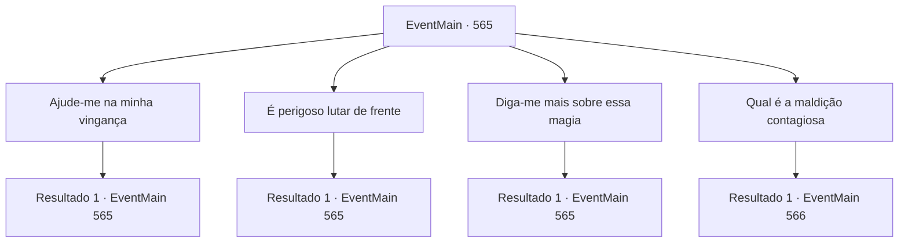

# Eventos principais · 565

[Índice da tabela](index.md) · [Índice geral](../index.md)

ID: `pt:EventMain:565` · Fonte: `EventMain4` · Versão: 1.2.47.

Mapeamento estático dos arquivos; a disponibilidade e a execução dependem do estado da run.

## Texto do evento

*Sem texto no arquivo.*

## Dados de entrada

```json
{
  "id": 565,
  "grade": 1,
  "normalGoal": "",
  "required": ""
}
```

## Mapa das escolhas



## Escolhas e resultados

### Escolha 1

Ajude-me na minha vingança

Requisitos e outros campos da escolha:

```json
{
  "required": "5_380_0"
}
```

#### Resultado 1.1

Gess responde com um sorriso estranho às suas palavras de ajudar na vingança. Sua voz está tremendo a ponto de ser desagradável. 

 "O, Claro. Co, Contratante... E, Estamos prontos para lutar contra os Teretianos agora mesmo pelo Mas, Mestre, e por você."

 Mas, ao contrário do que ele diz, os adoradores de demônios parecem bastante machucados pela luta que acabaram de ter. Parece desafiador enfrentar os paladinos de frente.

Continuação registrada: [Evento 565](0565.md) na mesma tabela.

```json
{
  "required": "",
  "chance": "1",
  "nextEvent": 565,
  "type": 2,
  "reward": "5_380_1"
}
```

### Escolha 2

É perigoso lutar de frente

Requisitos e outros campos da escolha:

```json
{
  "required": "5_380_1"
}
```

#### Resultado 2.1

Gess esfrega as mãos com suas palavras e diz lisonjeiramente. 

 "Como esperado, você tem uma grande perspicácia. Então, precisamos de Danica."

 Com isso dito, Gess sugere duas maneiras. Uma é usar magia para tomar o corpo de Danica e assassinar o arcebispo, A outra é colocar uma maldição altamente contagiosa nela e enviá-la para a catedral de Yerut.

Continuação registrada: [Evento 565](0565.md) na mesma tabela.

```json
{
  "required": "",
  "chance": "1",
  "nextEvent": 565,
  "type": 2,
  "reward": "5_380_2"
}
```

### Escolha 3

Diga-me mais sobre essa magia

Requisitos e outros campos da escolha:

```json
{
  "required": "5_380_2"
}
```

#### Resultado 3.1

Gess encolhe ligeiramente e responde com uma salivação. 

 "Th, A magia que le, leva o corpo embora é muito com, complicada, mas vamos pre, preparar tu, tudo."

 Gess diz que um feitiço de transferência de corpo é um feitiço que transfere a mente de alguém para o corpo de outra pessoa. Então você sabe todas as informações que a pessoa que é o sujeito do feitiço tem, e isso não afeta o sentido dos genitais que detectam a energia do demônio. Mas se o corpo de Danica estiver seriamente danificado, Ele te avisa que sua alma pode ser devastada. 

 "Sh, Ela está fraca, então se ela estiver em pe, perigo, Você precisa des, desfazer o feitiço."


Continuação registrada: [Evento 565](0565.md) na mesma tabela.

```json
{
  "required": "",
  "chance": "1",
  "nextEvent": 565,
  "type": 2,
  "reward": "5_380_3"
}
```

### Escolha 4

Qual é a maldição contagiosa

Requisitos e outros campos da escolha:

```json
{
  "required": "5_380_3"
}
```

#### Resultado 4.1


 "O cur, amaldiçoado, vai morrer em alguns dias. Hhehehe..."

 De acordo com Gess, visões que começam com a pessoa que encontra o corpo passam de pessoa para pessoa. Finalmente, todos na área verão uma visão terrível. 

 "Eles vão olhar uns aos outros como monstros."

 Então, os paladinos tentarão se matar. Gess pergunta qual dos dois métodos colocar em prática. 

 "Qual você gosta?"


Continuação registrada: [Evento 566](0566.md) na mesma tabela.

```json
{
  "required": "",
  "chance": "1",
  "nextEvent": 566,
  "type": 2,
  "reward": "5_380_4"
}
```

## Referências que chegam a este evento

- [Evento 564 · escolha 1 · resultado 1](0564.md#escolha-1)
- [Evento 565 · escolha 1 · resultado 1](0565.md#escolha-1)
- [Evento 565 · escolha 2 · resultado 1](0565.md#escolha-2)
- [Evento 565 · escolha 3 · resultado 1](0565.md#escolha-3)
