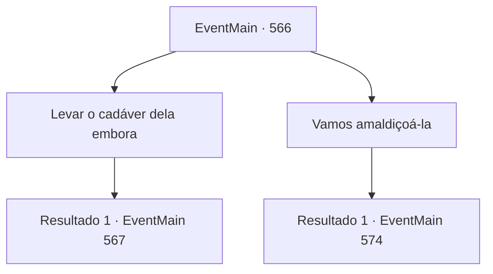

# Eventos principais · 566

[Índice da tabela](index.md) · [Índice geral](../index.md)

ID: `pt:EventMain:566` · Fonte: `EventMain4` · Versão: 1.2.47.

Mapeamento estático dos arquivos; a disponibilidade e a execução dependem do estado da run.

## Texto do evento

*Sem texto no arquivo.*

## Dados de entrada

```json
{
  "id": 566,
  "grade": 1,
  "normalGoal": "",
  "required": ""
}
```

## Mapa das escolhas



## Escolhas e resultados

### Escolha 1

Levar o cadáver dela embora

Requisitos e outros campos da escolha:

```json
{
  "required": ""
}
```

#### Resultado 1.1

Quando você escolhe um caminho para levar seu corpo embora, Gess te leva para o esconderijo. O esconderijo dos adoradores do demônio está escondido no subsolo na cidade de Kahida para evitar a vigilância de Teretian. 

 "Ta, Leve a garota e se prepare para a cer, cerimônia."

 Sob o comando de Gess, alguns adoradores levam Danica e vão para algum lugar.

 Alguns dias depois, o ritual começa na 'Sala do Sacrifício' no centro do esconderijo. Você se senta no círculo mágico e vê Danica amarrada firmemente a uma corda. 

 "Woop...!"

 Gess olha para ela fazendo um barulho, explicando a você as precauções. 

 "Quando a ce, cerimônia começar, sua, sua mente entrará na mi, mente de Danica. Deve haver o esp, espírito dela, e se você não l, lidar com isso, você não, não poderá levar o corpo dela."

 Você acena com a cabeça para as palavras de Gess e observa a cerimônia.

Continuação registrada: [Evento 567](0567.md) na mesma tabela.

```json
{
  "required": "",
  "chance": "1",
  "nextEvent": 567,
  "type": 2,
  "reward": ""
}
```

### Escolha 2

Vamos amaldiçoá-la

Requisitos e outros campos da escolha:

```json
{
  "required": ""
}
```

#### Resultado 2.1

Quando você escolhe uma forma de amaldiçoar, Gess te leva ao esconderijo. O esconderijo dos adoradores do demônio está escondido no subsolo da cidade de Kahida para evitar a vigilância de Teretian. 

 "Ta, Pegue a garota e g, prepare-se para a maldi, maldição."

 Sob o comando de Gess, alguns adoradores levam Danica e seguem para algum lugar.

 Alguns dias depois, quando Gess diz que tudo está pronto, você parte para o esconderijo. Danica está deitada morta na carruagem e dizem ter perdido a consciência devido a uma maldição. 

 "O Arce, Arcebispo Pu, Publius está na Ca, Catedral de Ye, Yerut."

 Assim que a carruagem parte, os adoradores do demônio caminham em direção à 'Catedral de Yerut'.

Continuação registrada: [Evento 574](0574.md) na mesma tabela.

```json
{
  "required": "",
  "chance": "1",
  "nextEvent": 574,
  "type": 2,
  "reward": ""
}
```

## Referências que chegam a este evento

- [Evento 565 · escolha 4 · resultado 1](0565.md#escolha-4)
