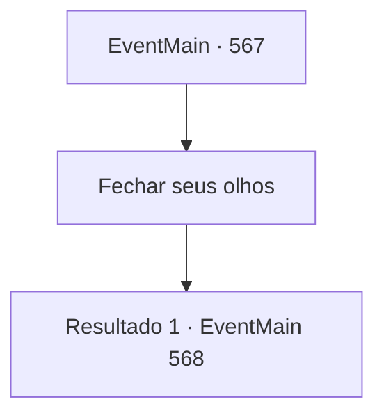

# Eventos principais · 567

[Índice da tabela](index.md) · [Índice geral](../index.md)

ID: `pt:EventMain:567` · Fonte: `EventMain4` · Versão: 1.2.47.

Mapeamento estático dos arquivos; a disponibilidade e a execução dependem do estado da run.

## Texto do evento

*Sem texto no arquivo.*

## Dados de entrada

```json
{
  "id": 567,
  "grade": 1,
  "normalGoal": "",
  "required": ""
}
```

## Mapa das escolhas



## Escolhas e resultados

### Escolha 1

Fechar seus olhos

Requisitos e outros campos da escolha:

```json
{
  "required": ""
}
```

#### Resultado 1.1

Em breve, a feitiçaria começa com o alto canto de Gess. Danica grita, revirando os olhos, e você está ficando cada vez mais embaçado. Você sente como se estivesse caindo em um sono profundo e sendo sugado para algum lugar. 

 O lugar onde você abre os olhos é estranho e misterioso. Há uma pequena cabana no vasto prado turquesa, e do outro lado está a Catedral de Teretian. Pequenos animais como esquilos e pardais vagam pacificamente, e uma canção de ninar pode ser ouvida de algum lugar. Você olha para a mente de Danica e percebe que está dentro dela.

Continuação registrada: [Evento 568](0568.md) na mesma tabela.

```json
{
  "required": "",
  "chance": "1",
  "nextEvent": 568,
  "type": 2,
  "reward": ""
}
```

## Referências que chegam a este evento

- [Evento 566 · escolha 1 · resultado 1](0566.md#escolha-1)
