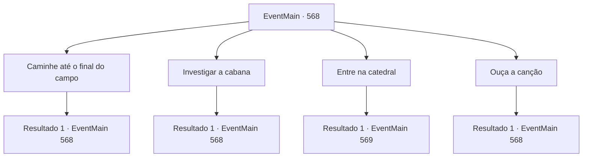

# Eventos principais · 568

[Índice da tabela](index.md) · [Índice geral](../index.md)

ID: `pt:EventMain:568` · Fonte: `EventMain4` · Versão: 1.2.47.

Mapeamento estático dos arquivos; a disponibilidade e a execução dependem do estado da run.

## Texto do evento

*Sem texto no arquivo.*

## Dados de entrada

```json
{
  "id": 568,
  "grade": 1,
  "normalGoal": "",
  "required": ""
}
```

## Mapa das escolhas



## Escolhas e resultados

### Escolha 1

Caminhe até o final do campo

Requisitos e outros campos da escolha:

```json
{
  "required": "5_381_0"
}
```

#### Resultado 1.1

Você caminha pelo prado e encontra o espírito dela. No entanto, não importa o quanto você caminhe, a grama é interminável e, após uma longa caminhada, você está de volta perto da cabana. Você tenta encontrar outro lugar e se vira.

Continuação registrada: [Evento 568](0568.md) na mesma tabela.

```json
{
  "required": "",
  "chance": "1",
  "nextEvent": 568,
  "type": 2,
  "reward": "5_381_1"
}
```

### Escolha 2

Investigar a cabana

Requisitos e outros campos da escolha:

```json
{
  "required": "5_382_0"
}
```

#### Resultado 2.1

Você olha para dentro através da janela do lado de fora da cabana. Você pode ver uma fogueira queimando dentro da lareira, uma linha colocada em uma cadeira de balanço e bonecas espalhadas pelo chão. Parece que alguém estava aqui há pouco tempo, mas Danica não é vista. Você desvia o olhar da janela e tenta olhar para outro lugar.

Continuação registrada: [Evento 568](0568.md) na mesma tabela.

```json
{
  "required": "",
  "chance": "1",
  "nextEvent": 568,
  "type": 2,
  "reward": "5_382_1"
}
```

### Escolha 3

Entre na catedral

Requisitos e outros campos da escolha:

```json
{
  "required": ""
}
```

#### Resultado 3.1

Você agarra a maçaneta e abre cuidadosamente a porta da frente da catedral. E assim que você está prestes a entrar, a voz de Danica é ouvida de cima. 

 "Saia daqui! Não suje seus pés sujos na catedral!"

 Ao olhar para cima, você vê Danica flutuando no ar da catedral. Ela parece translúcida e veste roupas desgastadas, ao contrário do que ela já viu na vida real. Você percebe que ela é o espírito de Danica e lentamente voa para cima.

Continuação registrada: [Evento 569](0569.md) na mesma tabela.

```json
{
  "required": "",
  "chance": "1",
  "nextEvent": 569,
  "type": 2,
  "reward": ""
}
```

### Escolha 4

Ouça a canção

Requisitos e outros campos da escolha:

```json
{
  "required": "5_383_0"
}
```

#### Resultado 4.1

Você ouve a música. A direção em que a música flui está acima do céu.  Você olha para o céu azul.  Mas não há nada para ser visto além de nuvens brancas e céu azul.  No final, você decide seguir outras pistas e se mover.

Continuação registrada: [Evento 568](0568.md) na mesma tabela.

```json
{
  "required": "",
  "chance": "1",
  "nextEvent": 568,
  "type": 2,
  "reward": "5_383_1"
}
```

## Referências que chegam a este evento

- [Evento 567 · escolha 1 · resultado 1](0567.md#escolha-1)
- [Evento 568 · escolha 1 · resultado 1](0568.md#escolha-1)
- [Evento 568 · escolha 2 · resultado 1](0568.md#escolha-2)
- [Evento 568 · escolha 4 · resultado 1](0568.md#escolha-4)
