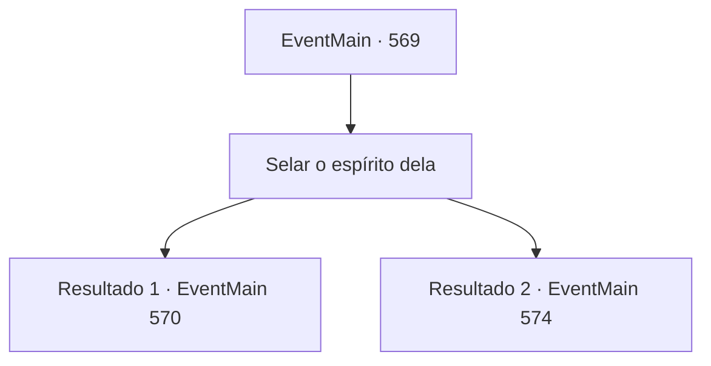

# Eventos principais · 569

[Índice da tabela](index.md) · [Índice geral](../index.md)

ID: `pt:EventMain:569` · Fonte: `EventMain4` · Versão: 1.2.47.

Mapeamento estático dos arquivos; a disponibilidade e a execução dependem do estado da run.

## Texto do evento

*Sem texto no arquivo.*

## Dados de entrada

```json
{
  "id": 569,
  "grade": 1,
  "normalGoal": "",
  "required": ""
}
```

## Mapa das escolhas



## Escolhas e resultados

### Escolha 1

Selar o espírito dela

Requisitos e outros campos da escolha:

```json
{
  "required": ""
}
```

#### Resultado 1.1

Você sela o espírito de Danica, suprimindo-o com sua sanidade. Ela resisti a você e causa uma tempestade no mundo mental, mas é eventualmente dominada por você. Você lentamente abre os olhos e vê o espírito de Danica se dissipar como uma névoa.

 Quando você abre os olhos, as memórias de Danica vêm como um tsunami. Sob o peso de tanta informação, você cambaleia e se levanta com o apoio de Gess. 

 "Con, Contratante. A, Você está bem?"

 Você refresca a memória de Danica respondendo a Gess que está tudo bem. Então, informações úteis vêm à mente como se tivessem estado lá desde o início. Publius está na 'Catedral de Yerut' de 'Regirique', uma cidade chamada Terra Santa de Tere. E sua residência fica no topo do pináculo atrás da catedral.

Continuação registrada: [Evento 570](0570.md) na mesma tabela.

```json
{
  "required": "",
  "chance": "1|0_14_1",
  "nextEvent": 570,
  "type": 0,
  "reward": ""
}
```

#### Resultado 1.2

Tentas selar o espírito de Danica, suprimindo-o com a tua sanidade. Mas ela resiste e causa uma tempestade no mundo mental. Finalmente, és expulso da mente dela. Gess aproxima-se de ti com uma expressão surpreendida enquanto abres os olhos em suores frios. 

 "Con, Contratante. E, Estás bem?"

 Olhas para Danica, respondendo a Gess que está tudo bem. Danica está a respirar pesadamente, mas a olhar para ti com olhos claros. Ordenas a Gess que a amaldiçoe. Gess aceita o teu pedido com um sorriso malicioso.

 Momentos depois, Danica, que está amaldiçoada, perde a consciência devido a uma febre alta. Gess e os adoradores de demónios levam Danica numa carruagem e dirigem-se à 'Catedral de Yerut', onde Publius reside.

Continuação registrada: [Evento 574](0574.md) na mesma tabela.

```json
{
  "required": "",
  "chance": "16",
  "nextEvent": 574,
  "type": 1,
  "reward": ""
}
```

## Referências que chegam a este evento

- [Evento 568 · escolha 3 · resultado 1](0568.md#escolha-3)
