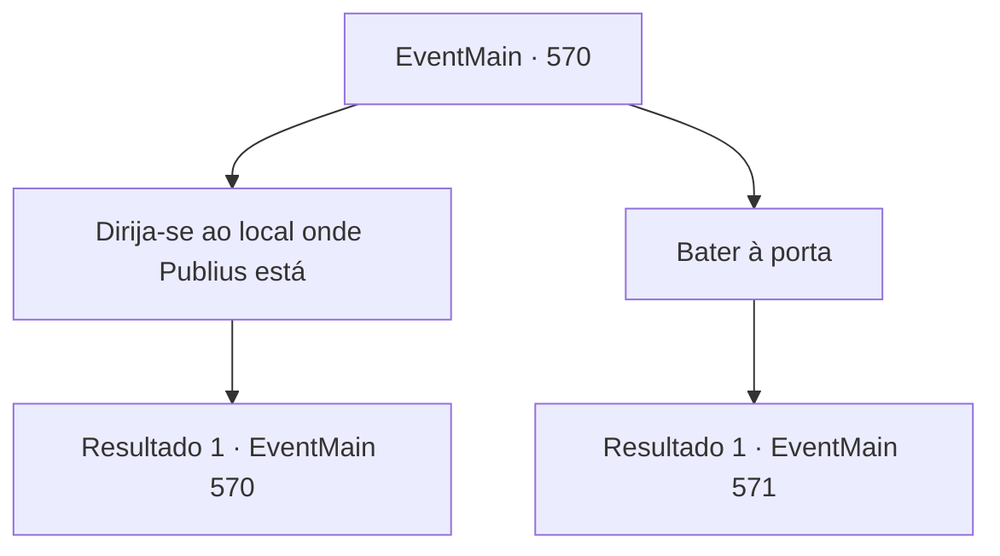

# Eventos principais · 570

[Índice da tabela](index.md) · [Índice geral](../index.md)

ID: `pt:EventMain:570` · Fonte: `EventMain4` · Versão: 1.2.47.

Mapeamento estático dos arquivos; a disponibilidade e a execução dependem do estado da run.

## Texto do evento

*Sem texto no arquivo.*

## Dados de entrada

```json
{
  "id": 570,
  "grade": 1,
  "normalGoal": "",
  "required": ""
}
```

## Mapa das escolhas



## Escolhas e resultados

### Escolha 1

Dirija-se ao local onde Publius está

Requisitos e outros campos da escolha:

```json
{
  "required": "5_384_0"
}
```

#### Resultado 1.1


 "Ta, Pegue isso, senhor."

 Gess lhe entrega uma adaga feita de prata. Ela está gravada com o padrão de Tere, que Gess lhe diz que era de Danica. 

 "Se você deixá-la no local onde o Arcebispo foi morto... Tenho certeza de que eles pensarão que é uma pista deixada pelo criminoso."

 Gess entrega a adaga e lhe diz como resolver a feitiçaria. E você pega a adaga em seus braços e pega a carruagem de Danica até a Catedral de Yerut. |drawing_tereCathedral| A Catedral de Yerut, que chegou após alguns dias de viagem, é esplêndida. Todo o prédio é feito de mármore, com uma cúpula azul no topo. Por toda a parede externa há esculturas e pinturas em mosaico em homenagem aos santos de Teretian. Você se esconde na escuridão da noite e entra na torre atrás da catedral. Então você sobe as escadas cuidadosamente e para em frente ao quarto de Publius no topo. Quando você segura a maçaneta, percebe que está trancada.

Continuação registrada: [Evento 570](0570.md) na mesma tabela.

```json
{
  "required": "",
  "chance": "1",
  "nextEvent": 570,
  "type": 2,
  "reward": "5_384_1|3_248_1"
}
```

### Escolha 2

Bater à porta

Requisitos e outros campos da escolha:

```json
{
  "required": "5_384_1"
}
```

#### Resultado 2.1

Quando você bate na porta, logo em seguida, uma voz de um velho é ouvida de cima da porta. 

 "... Quem está aí a essa hora?"

 Você ouve a voz e percebe que é Publius. Portanto, você o atrai dizendo que tem algo urgente para relatar na voz de Danica. Logo, a porta bem fechada se abre, e um Publius com rugas profundas aparece. 

 "Danica? Eu achei estranho porque você perdeu contato comigo... Entre."


Continuação registrada: [Evento 571](0571.md) na mesma tabela.

```json
{
  "required": "",
  "chance": "1",
  "nextEvent": 571,
  "type": 2,
  "reward": "5_384_2"
}
```

## Referências que chegam a este evento

- [Evento 569 · escolha 1 · resultado 1](0569.md#escolha-1)
- [Evento 570 · escolha 1 · resultado 1](0570.md#escolha-1)
