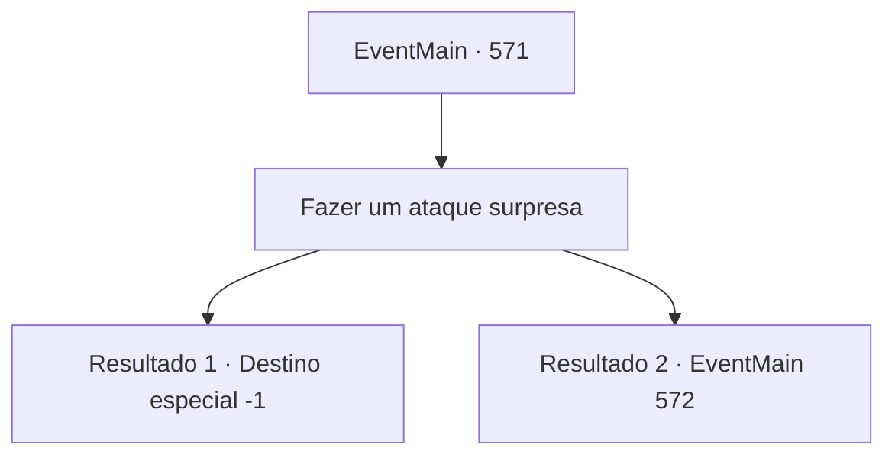

# Eventos principais · 571

[Índice da tabela](index.md) · [Índice geral](../index.md)

ID: `pt:EventMain:571` · Fonte: `EventMain4` · Versão: 1.2.47.

Mapeamento estático dos arquivos; a disponibilidade e a execução dependem do estado da run.

## Texto do evento

*Sem texto no arquivo.*

## Dados de entrada

```json
{
  "id": 571,
  "grade": 1,
  "normalGoal": "",
  "required": ""
}
```

## Mapa das escolhas



## Escolhas e resultados

### Escolha 1

Fazer um ataque surpresa

Requisitos e outros campos da escolha:

```json
{
  "required": ""
}
```

#### Resultado 1.1

<link=shake><color=red> 

 "Tosse! O que é isso...?"

</color></link> A lâmina de prata penetra entre as costelas de Publius. Publius ajoelha, vomitando sangue, e olha para você com um olhar questionador. Você sussurra baixinho para ele. 'É vingança pela minha família.' Os olhos de Publius estão cheios de espanto. 

 "De jeito nenhum... Você..."

 Você enfia uma adaga de prata em seu coração sem ouvi-lo. E sorri e observa o seu fim. 

 "Aha..! Ahahahaha!!!"

 Você explode em risos, e a voz de Danica ressoa. Logo, você dedica a alma de Publius a Kior e joga a adaga de prata junto ao corpo. E você sai dali com um sorriso satisfeito.

Continuação registrada: [Destino especial `-1`](../destinos-especiais.md).

```json
{
  "required": "",
  "chance": "1|0_6_1",
  "nextEvent": -1,
  "type": 0,
  "reward": "15_5_8|15_5_27|15_5_31"
}
```

#### Resultado 1.2


 "Kuk... O que é isso?"

 Publius está envergonhado, mas escapa do seu ataque surpresa. E bate em seu corpo com uma bengala. É um grande choque para o corpo pequeno de Danica. Você se levanta cambaleando. E Publius olha para você como se tentasse enxergar através de você. Porque a tentativa de assassinato falhou, você está com pressa para liberar a magia e sair do corpo de Danica. 

 "Entendo... Uma alma maligna entrou no corpo de Danica!"

 Então, Publius lança um feitiço, A corrente que sai de sua mão até o anel de luz se estende e agarra sua alma. 

 "Você se atreve! Para onde está tentando fugir?!"


Continuação registrada: [Evento 572](0572.md) na mesma tabela.

```json
{
  "required": "",
  "chance": "20",
  "nextEvent": 572,
  "type": 1,
  "reward": ""
}
```

## Referências que chegam a este evento

- [Evento 570 · escolha 2 · resultado 1](0570.md#escolha-2)
