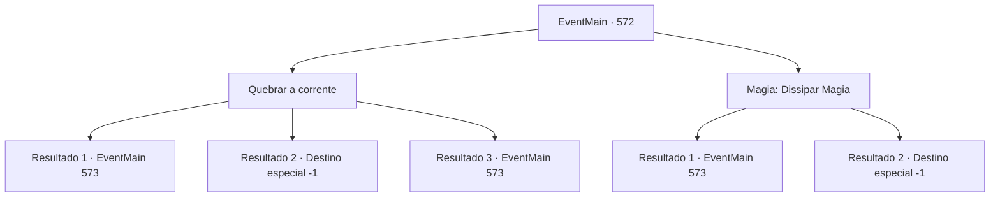

# Eventos principais · 572

[Índice da tabela](index.md) · [Índice geral](../index.md)

ID: `pt:EventMain:572` · Fonte: `EventMain4` · Versão: 1.2.47.

Mapeamento estático dos arquivos; a disponibilidade e a execução dependem do estado da run.

## Texto do evento

*Sem texto no arquivo.*

## Dados de entrada

```json
{
  "id": 572,
  "grade": 1,
  "normalGoal": "",
  "required": ""
}
```

## Mapa das escolhas



## Escolhas e resultados

### Escolha 1

Quebrar a corrente

Requisitos e outros campos da escolha:

```json
{
  "required": ""
}
```

#### Resultado 1.1

Você corta à força a corrente de Publius, Saia do corpo de Danica e retorne ao seu corpo. 

 "Ar, você está bem?"

 Gess olha para você com uma expressão preocupada, Você anuncia que o assassinato falhou. Então Gess diz com uma expressão triste. 

 "Tudo bem... tudo bem. Há, haverá outra cha, chance."

 Ele diz que sempre haverá uma chance de vingança se vivermos.

Continuação registrada: [Evento 573](0573.md) na mesma tabela.

```json
{
  "required": "",
  "chance": "1|0_14_1",
  "nextEvent": 573,
  "type": 0,
  "reward": ""
}
```

#### Resultado 1.2

Você não pode quebrar a corrente de Publius. A corrente começa a esquentar e queimar sua alma. Chamas brancas surgem da corrente, Isso faz você lutar em dor extrema. 

 "Desapareça, mal!"

 Com o grito de Publius, sua alma desaparece em chamas.

Continuação registrada: [Destino especial `-1`](../destinos-especiais.md).

```json
{
  "required": "24_7_1",
  "chance": "22",
  "nextEvent": -1,
  "type": 1,
  "reward": "0_0_-1|0_1_-1|15_5_13|15_5_15"
}
```

#### Resultado 1.3

Você corta à força a corrente de Publius, Saia do corpo de Danica e retorne ao seu corpo. 

 "Ar, você está bem?"

 Gess olha para você com uma expressão preocupada, Você anuncia que o assassinato falhou. Então Gess diz com uma expressão triste. 

 "Tudo bem... tudo bem. Há, haverá outra cha, chance."

 Ele diz que sempre haverá uma chance de vingança se vivermos.

Continuação registrada: [Evento 573](0573.md) na mesma tabela.

```json
{
  "required": "23_7_1",
  "chance": "11",
  "nextEvent": 573,
  "type": 1,
  "reward": "0_0_-1|0_1_-1|15_5_13|15_5_15"
}
```

### Escolha 2

Magia: Dissipar Magia

Requisitos e outros campos da escolha:

```json
{
  "required": "20_0_2|1_1_2"
}
```

#### Resultado 2.1

Você usa Dispel para cortar a corrente de Publius, Sai do corpo de Danica e retorna ao seu corpo. 

 "Ar, você está bem?"

 Gess olha para você com uma expressão preocupada, Você anuncia que o assassinato falhou. Então Gess diz com uma expressão triste. 

 "Tudo bem... tudo bem. Há, haverá outra cha, chance."

 Ele diz que sempre haverá uma chance de vingança se vivermos.

Continuação registrada: [Evento 573](0573.md) na mesma tabela.

```json
{
  "required": "",
  "chance": "1|0_7_1|0_12_1",
  "nextEvent": 573,
  "type": 0,
  "reward": "0_1_-1"
}
```

#### Resultado 2.2

Você não pode quebrar a corrente de Publius. A corrente começa a esquentar e queimar sua alma. Chamas brancas surgem da corrente, Isso faz você lutar em dor extrema. 

 "Desapareça, mal!"

 Com o grito de Publius, sua alma desaparece em chamas.

Continuação registrada: [Destino especial `-1`](../destinos-especiais.md).

```json
{
  "required": "",
  "chance": "20",
  "nextEvent": -1,
  "type": 1,
  "reward": "0_0_-1|0_1_-1|15_5_13|15_5_15"
}
```

## Referências que chegam a este evento

- [Evento 571 · escolha 1 · resultado 2](0571.md#escolha-1)
