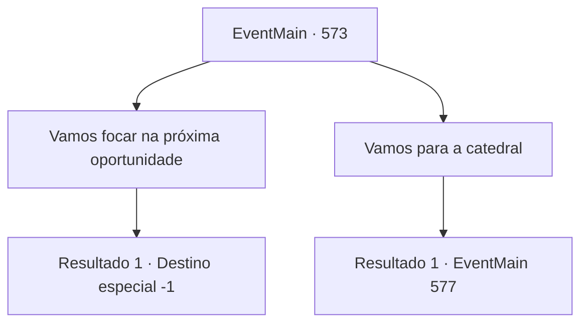

# Eventos principais · 573

[Índice da tabela](index.md) · [Índice geral](../index.md)

ID: `pt:EventMain:573` · Fonte: `EventMain4` · Versão: 1.2.47.

Mapeamento estático dos arquivos; a disponibilidade e a execução dependem do estado da run.

## Texto do evento

*Sem texto no arquivo.*

## Dados de entrada

```json
{
  "id": 573,
  "grade": 1,
  "normalGoal": "",
  "required": ""
}
```

## Mapa das escolhas



## Escolhas e resultados

### Escolha 1

Vamos focar na próxima oportunidade

Requisitos e outros campos da escolha:

```json
{
  "required": ""
}
```

#### Resultado 1.1

Você vai cuidar de si mesmo e buscar a próxima oportunidade. Então há um sussurro de Kior. 

 "Ok, isso é bom. Não há necessidade de ser morto."

 Como Kior e Gess dizem, haverá uma chance de vingança um dia. Você decide ficar escondido com adoradores de demônios.

Continuação registrada: [Destino especial `-1`](../destinos-especiais.md).

```json
{
  "required": "",
  "chance": "1",
  "nextEvent": -1,
  "type": 2,
  "reward": "15_5_18|15_5_41"
}
```

### Escolha 2

Vamos para a catedral

Requisitos e outros campos da escolha:

```json
{
  "required": ""
}
```

#### Resultado 2.1

Agora que esse é o caso, você diz para avançar de frente de uma maneira que não é nem fazer nem não fazer. Gess e os adoradores do demônio se curvam e respondem que aceitarão sua vontade. 

 Alguns dias depois, você chega perto de Regirique e olha para a cidade com adoradores. A cidade está cercada por três muralhas, e você pode ver um grande número de paladinos guardando o local. Então, como se estivessem esperando, o som da trombeta soou e o portão se abriu. 

 "Matem todos esses demônios!"

 Com o alto rugido de Publius, os paladinos se lançam para fora. E na frente, Valen os lidera. 

 "Oh... Está chegando! Todos, lutem!"

 A batalha entre os paladinos e os adoradores do demônio começa. E você também entra na luta.

Continuação registrada: [Evento 577](0577.md) na mesma tabela.

```json
{
  "required": "",
  "chance": "1",
  "nextEvent": 577,
  "type": 2,
  "reward": "6_0_148|5_434_1",
  "place": 0
}
```

## Referências que chegam a este evento

- [Evento 572 · escolha 1 · resultado 1](0572.md#escolha-1)
- [Evento 572 · escolha 1 · resultado 3](0572.md#escolha-1)
- [Evento 572 · escolha 2 · resultado 1](0572.md#escolha-2)
