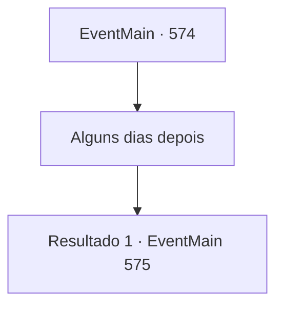

# Eventos principais · 574

[Índice da tabela](index.md) · [Índice geral](../index.md)

ID: `pt:EventMain:574` · Fonte: `EventMain4` · Versão: 1.2.47.

Mapeamento estático dos arquivos; a disponibilidade e a execução dependem do estado da run.

## Texto do evento

*Sem texto no arquivo.*

## Dados de entrada

```json
{
  "id": 574,
  "grade": 1,
  "normalGoal": "",
  "required": ""
}
```

## Mapa das escolhas



## Escolhas e resultados

### Escolha 1

Alguns dias depois

Requisitos e outros campos da escolha:

```json
{
  "required": ""
}
```

#### Resultado 1.1

|drawing_tereCathedral| Alguns dias depois, quando você chega perto da Catedral de Yerut, você sai da carruagem e se esconde com os fiéis. Então, apenas a carruagem com Danica foi enviada à catedral para esperar a maldição sair. 

 "Aaaaaaaaaaa!!!"

 No grito que irrompe, você percebe que seu plano foi bem-sucedido e segue para a Catedral de Yerut. Como esperado, os paladinos estão se atacando em confusão, e a catedral está encharcada de sangue deles. Você aproveita essa oportunidade e comanda os fiéis a atacá-los. Quando suas ordens são dadas, os fiéis gritam e se lançam contra os paladinos. 

 "O grande Tere no céu! Por favor, aos cordeiros assustados..."

 Nesse momento, um velho em um uniforme de padre vermelho brilhantemente bordado aparece e começa a lançar um feitiço. Você pode intuir que ele é 'Publius'.

Continuação registrada: [Evento 575](0575.md) na mesma tabela.

```json
{
  "required": "",
  "chance": "1",
  "nextEvent": 575,
  "type": 2,
  "reward": ""
}
```

## Referências que chegam a este evento

- [Evento 566 · escolha 2 · resultado 1](0566.md#escolha-2)
- [Evento 569 · escolha 1 · resultado 2](0569.md#escolha-1)
