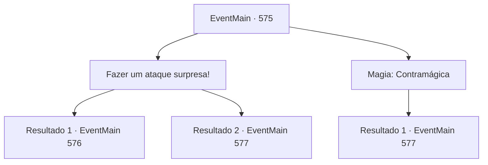

# Eventos principais · 575

[Índice da tabela](index.md) · [Índice geral](../index.md)

ID: `pt:EventMain:575` · Fonte: `EventMain4` · Versão: 1.2.47.

Mapeamento estático dos arquivos; a disponibilidade e a execução dependem do estado da run.

## Texto do evento

*Sem texto no arquivo.*

## Dados de entrada

```json
{
  "id": 575,
  "grade": 1,
  "normalGoal": "",
  "required": ""
}
```

## Mapa das escolhas



## Escolhas e resultados

### Escolha 1

Fazer um ataque surpresa!

Requisitos e outros campos da escolha:

```json
{
  "required": ""
}
```

#### Resultado 1.1

A catedral inteira está envolta em uma névoa que começa com uma maldição, e Publius, o alvo da sua vingança, está bem debaixo do seu nariz. Você pensa que não precisa mais se esconder, então você pula em direção a Publius. Então, com uma explosão de raiva, ele ataca Publius. 

 "Você... Você...!"

 Publius, que estava se preparando para o feitiço, interrompe o feitiço com o seu ataque surpresa. Você empunha sua arma novamente, com um golpe em sua respiração vacilante. No entanto, Publius lança flechas de luz em você como se ainda estivesse bem.

Continuação registrada: [Evento 576](0576.md) na mesma tabela.

```json
{
  "required": "",
  "chance": "1|0_6_1",
  "nextEvent": 576,
  "type": 0,
  "reward": "6_0_151",
  "place": 4
}
```

#### Resultado 1.2

A catedral inteira está envolta em uma névoa que começa com uma maldição, e Publius, o objeto da sua vingança, está bem debaixo do seu nariz. Você pensa que não precisa mais se esconder, então você pula em direção a Publius. Mas naquele exato momento. 

 "Não permita que você se aproxime do arcebispo!"

 Valen, uma paladina de cabelos vermelhos que aparece de algum lugar, bloqueia o seu caminho. Ela está te encarando e seus seguidores com um olhar mortal. Você muda o alvo para ela.

Continuação registrada: [Evento 577](0577.md) na mesma tabela.

```json
{
  "required": "",
  "chance": "16",
  "nextEvent": 577,
  "type": 1,
  "reward": "6_0_148",
  "place": 4
}
```

### Escolha 2

Magia: Contramágica

Requisitos e outros campos da escolha:

```json
{
  "required": "20_0_2"
}
```

#### Resultado 2.1

Você se apressa para lançar um Dispel para interromper a magia de Publius. Isso ocorre porque é óbvio que, se sua magia estiver sendo lançada, uma maldição desaparecerá. Mas a tentativa falha. Valen, o paladino de cabelos vermelhos, aparece de algum lugar e te impede. 

 "Não vou deixar você perturbar o Arcebispo!"

 Ela está te encarando e seus seguidores com um olhar mortal. Você interrompe o feitiço e a ataca.

Continuação registrada: [Evento 577](0577.md) na mesma tabela.

```json
{
  "required": "",
  "chance": "1",
  "nextEvent": 577,
  "type": 2,
  "reward": "6_0_148",
  "place": 4
}
```

## Referências que chegam a este evento

- [Evento 574 · escolha 1 · resultado 1](0574.md#escolha-1)
