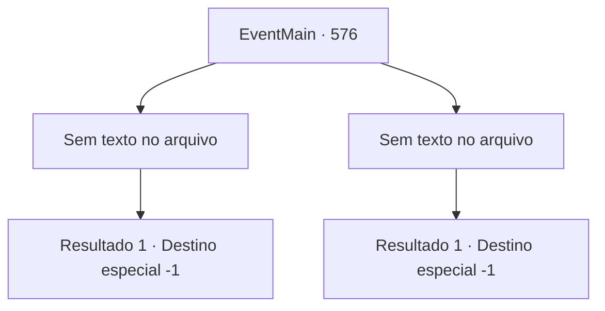

# Eventos principais · 576

[Índice da tabela](index.md) · [Índice geral](../index.md)

ID: `pt:EventMain:576` · Fonte: `EventMain4` · Versão: 1.2.47.

Mapeamento estático dos arquivos; a disponibilidade e a execução dependem do estado da run.

## Texto do evento

*Sem texto no arquivo.*

## Dados de entrada

```json
{
  "id": 576,
  "grade": 1,
  "normalGoal": "",
  "required": ""
}
```

## Mapa das escolhas



## Escolhas e resultados

### Escolha 1

*Sem texto no arquivo; o papel dessa opção depende da interface do jogo.*

Requisitos e outros campos da escolha:

```json
{
  "required": ""
}
```

#### Resultado 1.1


 "Tosse!... Para..O quê...?"

 Nos seus olhos questionáveis, você diz silenciosamente que é pela vingança da sua família. No entanto, o olhar dele está cheio de perguntas. 

 "Só, só por essa razão..!"

 Você não ouve as palavras de despedida de Publius, mas lhe dá uma morte miserável. Olhando para o seu fim, você sorri ao redor da boca. <link=shake> 

 "Argh! É um monstro!"

 "Meu braço! Meu braço!!!"

</link> Os paladinos da catedral ainda estão sob uma maldição. Eles estão ocupados perdendo suas vidas ou fugindo dos adoradores do demônio. Você dedica a alma de Publius a Kior em confusão. 

 "Kh..Kkkkk... Tudo bem. Estou encantado."

 A risada satisfatória de Kior é ouvida. Então Gess se aproxima e se curva para você. 

 "Eu, é tudo graças a você, con, contratante. Agora, nós derrubamos essa ca, catedral, nós pegamos, nós pegamos o altar que ser, serve o Ma, Mestre Kior...!"

 Ele está tão emocionado que não consegue falar corretamente entre lágrimas. Gess, que está soluçando por um tempo, pede para você continuar liderando-os. E você assente sem hesitar.

Continuação registrada: [Destino especial `-1`](../destinos-especiais.md).

```json
{
  "required": "",
  "chance": "1",
  "nextEvent": -1,
  "type": 2,
  "reward": "15_5_8|15_5_14|15_5_16"
}
```

### Escolha 2

*Sem texto no arquivo; o papel dessa opção depende da interface do jogo.*

Requisitos e outros campos da escolha:

```json
{
  "required": ""
}
```

#### Resultado 2.1

A magia de Publius te derrotou. Nesse momento, uma voz de mulher é ouvida junto com o som de passos. 

 "Arcebispo!"

 Ela é Valen. Publius te confia a Valen, que está com pressa e começa a gritar feitiços novamente. Você não precisa perguntar o que é. Isso porque os paladinos que lutam entre si param de lutar. 

 "Não pense que vai morrer confortavelmente."

 Valen chuta seu queixo com toda a força que pode. O campo de visão é abalado, então engolido pela escuridão.

Continuação registrada: [Destino especial `-1`](../destinos-especiais.md).

```json
{
  "required": "",
  "chance": "1",
  "nextEvent": -1,
  "type": 2,
  "reward": "0_0_-1|0_1_-1|15_5_2|15_5_13|15_5_17"
}
```

## Referências que chegam a este evento

- [Evento 575 · escolha 1 · resultado 1](0575.md#escolha-1)
