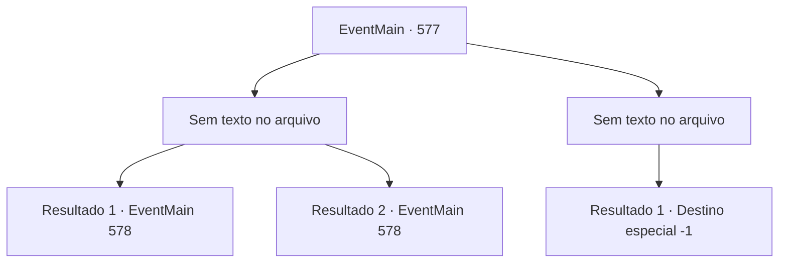

# Eventos principais · 577

[Índice da tabela](index.md) · [Índice geral](../index.md)

ID: `pt:EventMain:577` · Fonte: `EventMain4` · Versão: 1.2.47.

Mapeamento estático dos arquivos; a disponibilidade e a execução dependem do estado da run.

## Texto do evento

*Sem texto no arquivo.*

## Dados de entrada

```json
{
  "id": 577,
  "grade": 1,
  "normalGoal": "",
  "required": ""
}
```

## Mapa das escolhas



## Escolhas e resultados

### Escolha 1

*Sem texto no arquivo; o papel dessa opção depende da interface do jogo.*

Requisitos e outros campos da escolha:

```json
{
  "required": ""
}
```

#### Resultado 1.1

Sua espada, balançada como um raio, voa em sua direção. Você rapidamente contra-ataca o seu ataque, prende o pé dela e a empurra com o seu ombro. 

 "Ofegante!"

 Valen, que esbarra em você, perde o equilíbrio e cai. E você acerta a cabeça dela que caiu. Valen pode ter caído para a morte, mas ela não acorda mais. 

 "...Con, Contratante!"

 Então, você olha ao redor na voz de Gess, que chega apressado. Antes que você percebesse, a névoa que a cercava desapareceu, e os paladinos pararam de lutar entre si. No final, a maldição foi quebrada. 

 "Elimine o mal!"

 Logo em seguida, os paladinos, que recobraram a consciência, atacam você com o grito de Publius.

Continuação registrada: [Evento 578](0578.md) na mesma tabela.

```json
{
  "required": "18_434_1",
  "chance": "1",
  "nextEvent": 578,
  "type": 2,
  "reward": "6_0_149",
  "place": 4
}
```

#### Resultado 1.2

Sua espada é balançada como um raio voando em sua direção. Você rapidamente contra-ataca o seu ataque, segura o pé dela e a empurra com o seu ombro. 

 "Ofegante!"

 Valen, que esbarra em você, perde o equilíbrio e cai. E você acerta a cabeça dela que caiu. Valen pode ter caído para a morte, mas ela não acorda mais. 

 "...Con, Contratante!"

 Naquele momento, você olha ao redor ao ouvir a voz urgente de Gess. Antes que você percebesse, a névoa ao redor desapareceu, e os paladinos pararam de lutar entre si. No final, a maldição foi quebrada. 

 "Eliminem o mal!"

 Logo em seguida, os paladinos, que recobraram a consciência, atacam você com o grito de Publius.

Continuação registrada: [Evento 578](0578.md) na mesma tabela.

```json
{
  "required": "5_434_1",
  "chance": "1",
  "nextEvent": 578,
  "type": 2,
  "reward": "6_0_149",
  "place": 4
}
```

### Escolha 2

*Sem texto no arquivo; o papel dessa opção depende da interface do jogo.*

Requisitos e outros campos da escolha:

```json
{
  "required": ""
}
```

#### Resultado 2.1

Publius, que vê você cair, mal consegue se levantar e começa a gritar feitiços. 

 "Tere! Por favor, livre-se do poder maligno que está ligado aos cordeiros!"

 Você não precisa perguntar o que ele faz. Isso porque os paladinos que lutavam entre si pararam de lutar. 

 "Não pense que vai morrer confortavelmente."

 Valen chuta seu queixo com toda a força que pode. O campo de visão é abalado, então engolido pela escuridão.

Continuação registrada: [Destino especial `-1`](../destinos-especiais.md).

```json
{
  "required": "",
  "chance": "1",
  "nextEvent": -1,
  "type": 2,
  "reward": "0_0_-1|0_1_-1|15_5_2|15_5_13|15_5_17"
}
```

## Referências que chegam a este evento

- [Evento 573 · escolha 2 · resultado 1](0573.md#escolha-2)
- [Evento 575 · escolha 1 · resultado 2](0575.md#escolha-1)
- [Evento 575 · escolha 2 · resultado 1](0575.md#escolha-2)
