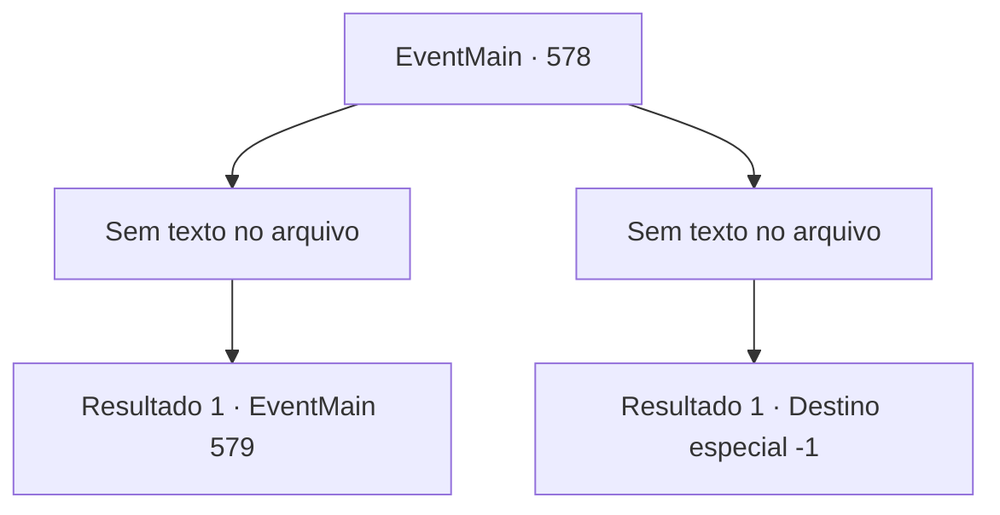

# Eventos principais · 578

[Índice da tabela](index.md) · [Índice geral](../index.md)

ID: `pt:EventMain:578` · Fonte: `EventMain4` · Versão: 1.2.47.

Mapeamento estático dos arquivos; a disponibilidade e a execução dependem do estado da run.

## Texto do evento

*Sem texto no arquivo.*

## Dados de entrada

```json
{
  "id": 578,
  "grade": 1,
  "normalGoal": "",
  "required": ""
}
```

## Mapa das escolhas



## Escolhas e resultados

### Escolha 1

*Sem texto no arquivo; o papel dessa opção depende da interface do jogo.*

Requisitos e outros campos da escolha:

```json
{
  "required": ""
}
```

#### Resultado 1.1

A espada avança. Você a deixa escapar e acerta o inimigo na cabeça. Uma lança se aproxima. Você se afasta dela e quebra o cabo da lança. Você é simplesmente a encarnação da vingança. Os paladinos não conseguem te vencer, e com a ajuda dos adoradores de demônios, todos eles finalmente caem. Nesse momento, Publius, que permaneceu sozinho e empunhando uma arma, grita com uma voz sincera. 

 "Poderoso Tere! Eu te darei tudo! Pelo amor de Deus, me dê a força para derrotar o mal!"

 A luz intensa se coagula no corpo de Publius, que está sozinho, e seu rosto começa a rachar. Kior vê isso e grita urgentemente. 

 "Maldição! Tragam a alma dele!"


Continuação registrada: [Evento 579](0579.md) na mesma tabela.

```json
{
  "required": "",
  "chance": "1",
  "nextEvent": 579,
  "type": 2,
  "reward": ""
}
```

### Escolha 2

*Sem texto no arquivo; o papel dessa opção depende da interface do jogo.*

Requisitos e outros campos da escolha:

```json
{
  "required": ""
}
```

#### Resultado 2.1

Você é derrotado pelo implacável ataque dos paladinos. Sangue escorre de sua boca e você acaba de joelhos. Então, uma voz alta de Publius é ouvida ao longe. 

 "Não matem ainda! Esse malfeitor não pode ser morto tão facilmente! Levem-no!"

 Quando você olha para cima, vê Publius com olhos frios olhando para você. Os paladinos o capturam e arrastam para a prisão. Você fecha os olhos, sentindo que tudo acabou.

Continuação registrada: [Destino especial `-1`](../destinos-especiais.md).

```json
{
  "required": "",
  "chance": "1",
  "nextEvent": -1,
  "type": 2,
  "reward": "0_0_-1|0_1_-1|15_5_2|15_5_13|15_5_17"
}
```

## Referências que chegam a este evento

- [Evento 577 · escolha 1 · resultado 1](0577.md#escolha-1)
- [Evento 577 · escolha 1 · resultado 2](0577.md#escolha-1)
